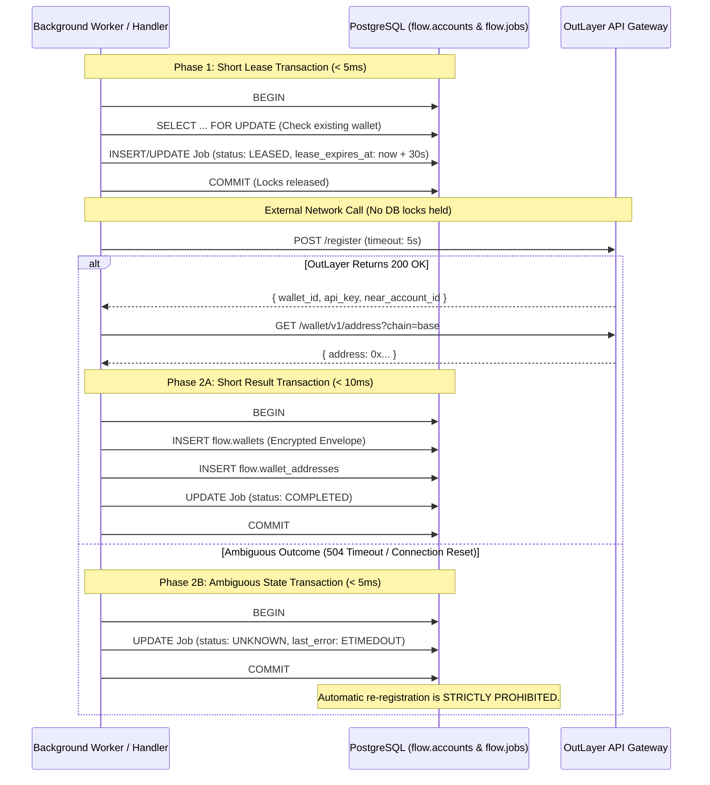

# FLOW M2 custody and wallet architecture

**6 November 2026 · Phase 1: Cryptography, Contracts & State Machine Specification**

This document establishes the architecture for FLOW's wallet custody integration with OutLayer.

---

## 1. OutLayer registration models & recovery comparison

### 1.1 Anonymous random registration vs. deterministic NEAR-bound registration

| Feature                       | Anonymous Random (`POST /register {}`)                                                                       | Deterministic NEAR-Bound (`POST /register { account_id, pubkey, ... }`)                                         |
| ----------------------------- | ------------------------------------------------------------------------------------------------------------ | --------------------------------------------------------------------------------------------------------------- |
| **Identity anchor**           | Random UUID generated by OutLayer enclave.                                                                   | Bound to a verified NEAR account ID via NEP-413 signature.                                                      |
| **Credential issuance**       | Single-use bearer key (`wk_...`), shown once.                                                                | Operational key (`wk_...`) paired with NEAR account full-access key.                                            |
| **Lost credential recovery**  | **Unrecoverable.** If `wk_...` is lost, the wallet is unreachable.                                           | **Recoverable.** Account owner can sign with NEAR key (`POST /wallet/v1/auth-sign`) to rotate/reissue `wk_...`. |
| **Retry safety on ambiguity** | **Unsafe.** Calling `POST /register` again creates an entirely new, disconnected wallet container.           | **Safer.** Re-registering with the same NEAR account / seed can deterministically map to the same wallet.       |
| **Prerequisites**             | Zero on-chain dependencies; instantaneous.                                                                   | Requires a funded NEAR account with full-access key before registration.                                        |
| **FLOW Phase 2 strategy**     | Primary for initial personal accounts, wrapped with strict `UNKNOWN` state machine to isolate lost attempts. | Evaluated for FLOW business accounts and treasury vaults where a dedicated NEAR controller is available.        |

---

## 2. Durable provisioning state machine & lease management

### 2.1 Database transaction boundary rule

> [!IMPORTANT]
> **No database transaction locks are held across external provider network calls.** Holding row locks or open transactions across HTTP I/O risks connection pool starvation, transaction timeouts, and cascading database failures.

### 2.2 Two-phase leased execution



---

## 3. Cryptographic envelope & KMS migration path

### 3.1 Versioned envelope specification (`src/foundation/crypto-envelope.ts`)

```typescript
export interface EncryptedEnvelope {
  readonly version: 1;
  readonly algorithm: "aes-256-gcm";
  readonly keyId: string; // Identifier of the active key (e.g. "v1", "kms-key-arn")
  readonly ciphertext: string; // Base64 payload
  readonly iv: string; // Base64 96-bit initialization vector
  readonly tag: string; // Base64 128-bit authentication tag
}
```

1. **Authentication:** AES-256-GCM guarantees ciphertext authenticity and confidentiality. Any bit-flip in ciphertext, IV, or tag produces a `DECRYPTION_FAILED` error.
2. **Rotation:** `rotateEnvelope` decrypts under the old key and re-encrypts under a new key and `keyId`, allowing zero-downtime key rotation.
3. **KMS Migration Path:** When migrating to AWS KMS, GCP KMS, or HashiCorp Vault, the `keyId` field will store the KMS Key ARN/URI. The envelope structure remains 100% backwards-compatible.

---

## 4. Multi-chain capabilities and network validation

### 4.1 Address verification rules

- **NEAR Protocol:**
  - Implicit accounts: Exactly 64 lowercase hexadecimal characters (representing a 32-byte ed25519 public key).
  - Named accounts: 2–64 characters separated by `.`, `-`, or `_`.
- **EVM (Base / Ethereum):** `0x` prefix followed by 40 hexadecimal characters.
- **Solana:** Base58-encoded string of 32–44 characters.

### 4.2 Network execution & broadcast separation

| Network      | Derive Address | Native Balance | Intents Balance | Sign Transfer | Broadcast Responsibility |
| ------------ | :------------: | :------------: | :-------------: | :-----------: | ------------------------ |
| **NEAR**     |      Yes       |      Yes       |       Yes       |      Yes      | **OutLayer Enclave**     |
| **Base**     |      Yes       | No (Base RPC)  |       No        |   Yes (Raw)   | **FLOW Application**     |
| **Ethereum** |      Yes       |  No (ETH RPC)  |       No        |   Yes (Raw)   | **FLOW Application**     |
| **Solana**   |      Yes       |  No (SOL RPC)  |       No        |   Yes (Raw)   | **FLOW Application**     |
| **Bitcoin**  |       No       |       No       |       No        |      No       | **Unsupported by v1**    |
