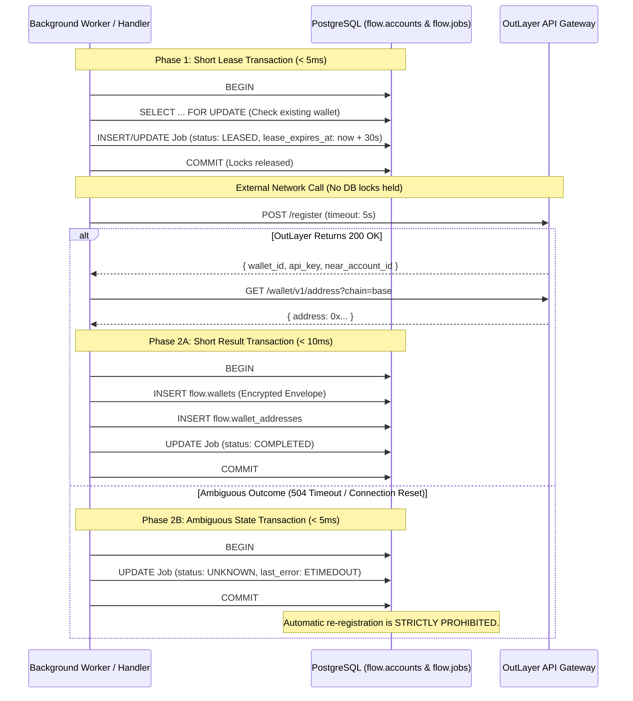
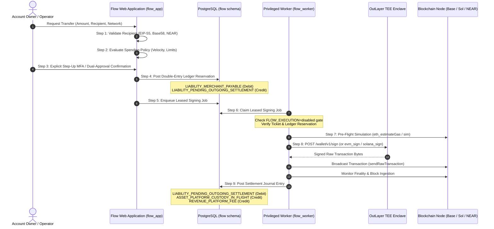

# FLOW M2 custody and wallet architecture

**6 November 2026 · Phase 1: Cryptography, Contracts & State Machine Specification**

This document establishes the architecture for FLOW's wallet custody integration with OutLayer.

---

## 1. OutLayer registration models & recovery comparison

### 1.1 Anonymous random registration vs. deterministic NEAR-bound registration

| Feature                       | Anonymous Random (`POST /register {}`)                                                                       | Deterministic NEAR-Bound (`POST /register { account_id, pubkey, ... }`)                                         |
| ----------------------------- | ------------------------------------------------------------------------------------------------------------ | --------------------------------------------------------------------------------------------------------------- |
| **Identity anchor**           | Random UUID generated by OutLayer enclave.                                                                   | Bound to a verified NEAR account ID via NEP-413 signature.                                                      |
| **Credential issuance**       | Single-use bearer key (`wk_...`), shown once.                                                                | Operational key (`wk_...`) paired with NEAR account full-access key.                                            |
| **Lost credential recovery**  | **Unrecoverable.** If `wk_...` is lost, the wallet is unreachable.                                           | **Recoverable.** Account owner can sign with NEAR key (`POST /wallet/v1/auth-sign`) to rotate/reissue `wk_...`. |
| **Retry safety on ambiguity** | **Unsafe.** Calling `POST /register` again creates an entirely new, disconnected wallet container.           | **Safer.** Re-registering with the same NEAR account / seed can deterministically map to the same wallet.       |
| **Prerequisites**             | Zero on-chain dependencies; instantaneous.                                                                   | Requires a funded NEAR account with full-access key before registration.                                        |
| **FLOW Phase 2 strategy**     | Primary for initial personal accounts, wrapped with strict `UNKNOWN` state machine to isolate lost attempts. | Evaluated for FLOW business accounts and treasury vaults where a dedicated NEAR controller is available.        |

---

## 2. Durable provisioning state machine & lease management

### 2.1 Database transaction boundary rule

> [!IMPORTANT]
> **No database transaction locks are held across external provider network calls.** Holding row locks or open transactions across HTTP I/O risks connection pool starvation, transaction timeouts, and cascading database failures.

### 2.2 Two-phase leased execution



---

## 3. Cryptographic envelope & KMS migration path

### 3.1 Versioned envelope specification (`src/foundation/crypto-envelope.ts`)

```typescript
export interface EncryptedEnvelope {
  readonly version: 1;
  readonly algorithm: "aes-256-gcm";
  readonly keyId: string; // Identifier of the active key (e.g. "v1", "kms-key-arn")
  readonly ciphertext: string; // Base64 payload
  readonly iv: string; // Base64 96-bit initialization vector
  readonly tag: string; // Base64 128-bit authentication tag
}
```

1. **Authentication:** AES-256-GCM guarantees ciphertext authenticity and confidentiality. Any bit-flip in ciphertext, IV, or tag produces a `DECRYPTION_FAILED` error.
2. **Rotation:** `rotateEnvelope` decrypts under the old key and re-encrypts under a new key and `keyId`, allowing zero-downtime key rotation.
3. **KMS Migration Path:** When migrating to AWS KMS, GCP KMS, or HashiCorp Vault, the `keyId` field will store the KMS Key ARN/URI. The envelope structure remains 100% backwards-compatible.

---

## 4. Multi-chain capabilities and network validation

### 4.1 Address verification rules

- **NEAR Protocol:**
  - Implicit accounts: Exactly 64 lowercase hexadecimal characters (representing a 32-byte ed25519 public key).
  - Named accounts: 2–64 characters separated by `.`, `-`, or `_`.
- **EVM (Base / Ethereum):** `0x` prefix followed by 40 hexadecimal characters.
- **Solana:** Base58-encoded string of 32–44 characters.

### 4.2 Network execution & broadcast separation

| Network      | Derive Address | Native Balance | Intents Balance | Sign Transfer | Broadcast Responsibility |
| ------------ | :------------: | :------------: | :-------------: | :-----------: | ------------------------ |
| **NEAR**     |      Yes       |      Yes       |       Yes       |      Yes      | **OutLayer Enclave**     |
| **Base**     |      Yes       | No (Base RPC)  |       No        |   Yes (Raw)   | **FLOW Application**     |
| **Ethereum** |      Yes       |  No (ETH RPC)  |       No        |   Yes (Raw)   | **FLOW Application**     |
| **Solana**   |      Yes       |  No (SOL RPC)  |       No        |   Yes (Raw)   | **FLOW Application**     |
| **Bitcoin**  |       No       |       No       |       No        |      No       | **Unsupported by v1**    |

---

## 5. Encrypted credential backup and key-rotation/recovery procedures

### 5.1 Defense-in-depth credential storage

1. **Encrypted at Rest:** Flow stores custody credentials (OutLayer API keys `wk_...` and NEAR private keys) inside an authenticated AES-256-GCM envelope (`flow.wallets.encrypted_credential`).
2. **Column-Level Role Revocation:** The ordinary web application database role (`flow_app`) has column-level `SELECT` completely revoked on `encrypted_credential`, `key_id`, and `key_digest`. Only the privileged out-of-process worker role (`flow_worker`) has database read access.
3. **Encrypted Backup Vault:** Automated database backups (pg_dump / WAL shipping) contain only ciphertext. Decryption requires the off-database master key (`FLOW_CUSTODY_ENVELOPE_KEY`), which is injected exclusively into worker container environments via secure secret managers (e.g. AWS Secrets Manager, GCP Secret Manager, Vault).

### 5.2 Zero-downtime key rotation procedure

1. **Multi-Key Configuration:** The application supports versioned keys (`v1`, `v2`, etc.). When rotating keys:
   - Configure the new key under a new `keyId` (e.g., `v2`).
   - Keep the old key configured as a secondary decryption key.
2. **Re-encryption Migration Job:** An offline worker job reads rows from `flow.wallets` where `key_id != current_key_id`, decrypts using the envelope's stamped `key_id`, re-encrypts under the current `keyId`, and updates `encrypted_credential`, `key_id`, and `key_digest` in a single transaction.
3. **Old Key Decommissioning:** Once all records in `flow.wallets` are stamped with the new `keyId`, the retired key is safely removed from runtime configuration.

### 5.3 Recovery safety & duplicate prevention

- **No Silent Re-Registration:** If credential recovery fails or an external request outcome is ambiguous, Flow transitions the provisioning job to `UNKNOWN` or `MANUAL_REVIEW`.
- **Wallet Immutability:** Any attempt to reset a provisioning job to `PENDING` when a wallet record already exists for the account is rejected with `INVALID_STATE_TRANSITION` (`Cannot reset job to PENDING when a wallet record already exists for the account`). Funded wallets are never replaced or deleted automatically.

---

## 6. OutLayer transaction signing analysis (confirmed vs. assumed)

| Blockchain Ecosystem      | Confirmed Capabilities (OutLayer OpenAPI 0.1.0-alpha.4)                                                                                                      | Assumed / Unverified (Flow Responsibilities)                                                                                                                                                               | Broadcast Mode                                |
| ------------------------- | ------------------------------------------------------------------------------------------------------------------------------------------------------------ | ---------------------------------------------------------------------------------------------------------------------------------------------------------------------------------------------------------- | --------------------------------------------- |
| **NEAR Protocol**         | • Account creation in enclave<br>• Address derivation via Ed25519<br>• Native transfer and NEP-141 token transfers<br>• Direct enclave broadcast to NEAR RPC | • Assumed high-availability NEAR RPC<br>• Pre-flight balance sufficiency checking is handled by Flow<br>• Gas budgeting and receipt finality tracking                                                      | `provider_broadcast`<br>(OutLayer broadcasts) |
| **EVM (Base & Ethereum)** | • Derives secp256k1 public keys & EIP-55 addresses<br>• Signs raw transaction payloads (`evm_sign`)<br>• Returns RLP/EIP-1559 signed transaction bytes       | • **Does NOT broadcast to EVM chains**<br>• Flow worker must manage nonces, base fee, priority fee, and submit `eth_sendRawTransaction`<br>• Flow must monitor confirmations, reorgs, and gas acceleration | `caller_broadcast`<br>(Flow broadcasts)       |
| **Solana**                | • Derives Ed25519 addresses & public keys<br>• Signs compiled transaction payloads (`solana_sign`)<br>• Returns wire-format signed transaction               | • **Does NOT broadcast to Solana**<br>• Flow worker must obtain latest blockhash, simulate transaction, submit `sendTransaction`, and poll signature commitment                                            | `caller_broadcast`<br>(Flow broadcasts)       |
| **Bitcoin**               | • **Unsupported in wallet v1**                                                                                                                               | • OutLayer documentation explicitly notes Bitcoin is not serviced                                                                                                                                          | `unsupported`                                 |

---

## 7. Outgoing financial authorization & signing pipeline

Every outgoing transaction follows an authoritative, 8-step policy-controlled pipeline:



---

## 8. Separation of login authentication vs. financial authorization

1. **Authentication Boundary (Identity):**
   - Logging in via Google OAuth or Email OTP establishes an `AuthSession` cookie.
   - This proves the caller's identity and account membership.
   - **Crucial Rule:** An `AuthSession` grants read access to authorized tenant portfolios, but has zero capability to move money or read private keys.
2. **Authorization Boundary (Money Movement):**
   - Outgoing payments require an independent, explicit financial authorization ticket (`FinancialTransferIntent`).
   - Financial authorization enforces spending policies, daily velocity counters, recipient checksums, dual-operator approval (for business accounts), and pre-ledger balance reservation.
   - The signing worker asserts that caller role is strictly `flow_worker` and verifies cryptographic ticket possession before calling OutLayer.
3. **Execution Guardrail:**
   - All signing and money movement remains strictly blocked while `FLOW_EXECUTION=disabled`.
