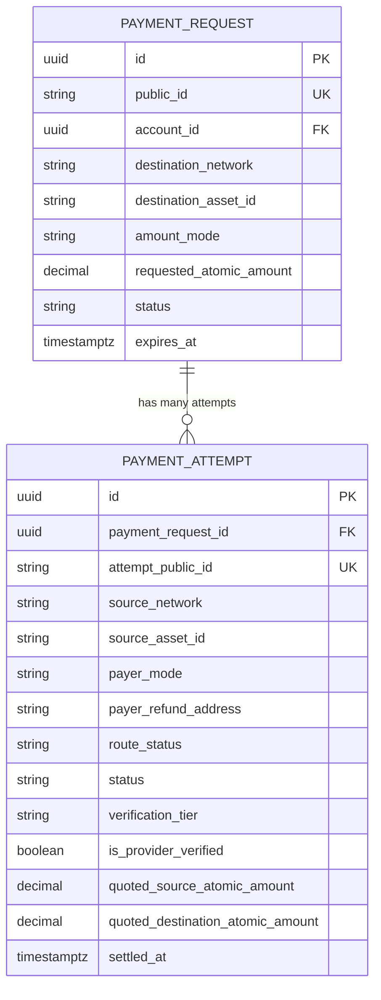
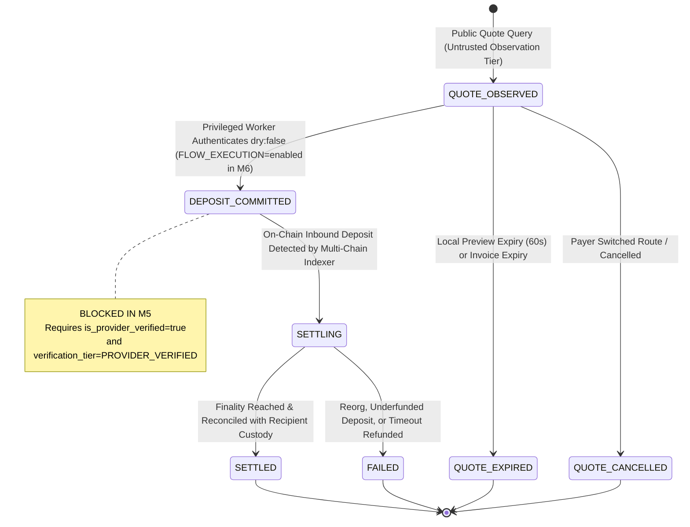
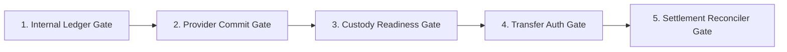

# FLOW — M5 Payment Settlement Readiness & Lifecycle Architecture

**Invoice, Multiple Attempts, Single Settlement, and Minimum Pre-Deposit Readiness Gates**

---

### 1. Invoice vs. Attempt Model

In Flow's payment architecture:

- An **Invoice** ([`flow.payment_requests`](file:///Users/user/Documents/Codex/2026-11-06/th/prisma/schema.prisma#L590)) represents the recipient's requested financial intent: settlement network, settlement asset, amount (fixed or optional), recipient account, and expiration.
- A **Payment Attempt** ([`flow.payment_attempts`](file:///Users/user/Documents/Codex/2026-11-06/th/prisma/schema.prisma#L616)) represents a specific route query or execution attempt initiated by a payer (e.g., paying via Solana SOL, or trying Ethereum USDT, or retrying after a quote expires).



---

### 2. Payment Attempt Lifecycle State Machine

Each payment attempt progresses through clearly delineated, strictly enforced state boundaries:



#### Settlement Idempotency Enforcement

To guarantee that multiple quotes or parallel payer attempts can **never** be misinterpreted as duplicate completed payments:

1. **Unique Settlement Index:**
   ```sql
   CREATE UNIQUE INDEX uq_payment_request_settled_attempt
   ON flow.payment_attempts (payment_request_id)
   WHERE status IN ('SETTLING', 'SETTLED');
   ```
   PostgreSQL enforces that at most **one** attempt per payment request can ever hold an active settling or settled status.
2. **Atomic Transition:**
   Transitioning an attempt to `SETTLED` atomically updates the parent `flow.payment_requests` status to `COMPLETED` within a single database transaction.
3. **Privilege Boundary:**
   Untrusted web app callers can only insert records in `QUOTE_OBSERVED` status with `verification_tier = 'UNVERIFIED_OBSERVATION'`. Only the privileged worker (`flow_worker`) can transition an attempt into `DEPOSIT_COMMITTED` or `SETTLED`.

---

### 3. The Five Minimum Pre-Deposit Readiness Gates

Before any live deposit address can be issued or any payment accepted from a payer, the following five architectural gates must be satisfied:



#### Gate 1: Internal Double-Entry Ledger Gate

- **Requirement:** Before presenting a deposit address, Flow must create an internal pending ledger journal entry recording the expected inbound asset, source chain, destination settlement asset, and merchant balance accrual.
- **Current Status:** Not yet implemented. Currently blocked until internal double-entry ledger tables are provisioned.

#### Gate 2: Provider Commit Gate (`dry: false`)

- **Requirement:** Execute an authenticated, signed provider commitment call (`dry: false`) to lock in the quote rate, generate the real provider invoice address, and acquire the provider correlation ID.
- **Current Status:** Unconditionally blocked (`FLOW_EXECUTION=disabled`). All queries strictly use `dry: true`.

#### Gate 3: Custody & Sweep Policy Gate

- **Requirement:** Verify that the recipient's destination account owns an active, provisioned OutLayer MPC/multisig wallet (`flow.wallets` with `status = 'PROVISIONED'`), and that automated sweep/settlement policies are cryptographically registered.
- **Current Status:** Wallets are provisioned for testnets/staging; mainnet live sweeping policies are held behind M6.

#### Gate 4: Transfer Authorization Gate

- **Requirement:** Payer transfer validation:
  - If self-custody wallet: verify sender transaction signature and destination address.
  - If exchange withdrawal: verify explicit personal refund address is registered with provider solver and sender-independent refunding is active.
- **Current Status:** Format validation implemented in M5 Phase 2 & 3. Live transaction monitoring staged for M6.

#### Gate 5: Finality & Settlement Reconciler Gate

- **Requirement:** Ingestion of actual verified on-chain block/slot events via the multi-chain activity indexer (`flow.wallet_activities`), waiting for requisite chain finality (e.g. 64 blocks on Base, finalized slot on Solana, final execution block on NEAR), and reconciling against the internal ledger.
- **Current Status:** Read-only indexers built in M3 Phase 4; automated settlement reconciliation hook staged for M6.
