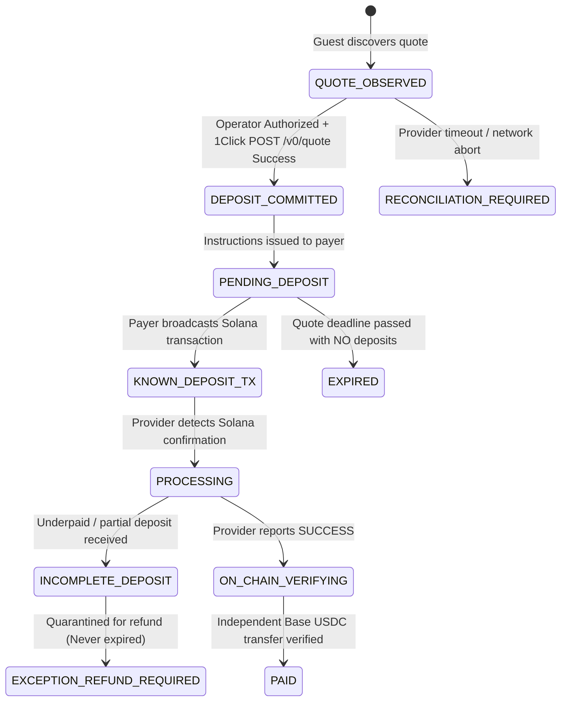

# FLOW — Final Corrections Before First Real $1 Inbound Payment

**Milestone Report · 11 November 2026**  
**Repository Baseline:** `359cf8a`  
**GitHub Actions CI Run:** [43004026639](https://github.com/OpeyemiMoses/Flow/actions/runs/43004026639) — **STATUS: SUCCESS / ALL CHECKS GREEN**

---

## 1. Executive Summary & Final Recommendation

| Dimension                      | Assessment                 | Operational Status                                                                                                                |
| :----------------------------- | :------------------------- | :-------------------------------------------------------------------------------------------------------------------------------- |
| **Payer Refund Ownership**     | Verified & Enforced        | Recipient's OutLayer address strictly prohibited; payer-controlled address required.                                              |
| **Exact Payer Cost Cap**       | Bound & Verified           | Source amount bound in SOL atomic units (lamports); separate network fee accounting; no guaranteed USD assumptions.               |
| **Commit Timeout Safety**      | Verified & Tested          | `RECONCILIATION_REQUIRED` state recorded on network timeout; duplicate commitments blocked.                                       |
| **Payment Status & Lifecycle** | Formally Hardened          | `INCOMPLETE_DEPOSIT` handled distinctly; no premature expiration or refund assumption.                                            |
| **Real Settlement Invariant**  | Cryptographically Enforced | Independent Base USDC on-chain transfer verification required before marking FLOW `PAID`.                                         |
| **Rehearsal Authorization**    | Single-Use Hardened        | Scoped single-use authorization guard verified while `FLOW_EXECUTION=disabled` and `can_sign_transfer=false`.                     |
| **CI Verification**            | **100% Pass**              | Run `43004026639` verified completely green across all 185 unit tests, Playwright browser tests, migrations, and security bounds. |
| **Final Recommendation**       | **CONDITIONAL GO**         | **GO** for exactly ONE owner-approved low-value ($1 USDC) live inbound payment rehearsal following the exact steps in Section 7.  |

---

## 2. Payer Refund Ownership Audit

### Identified Risk & Architecture Correction

During cross-chain deposits through 1Click, if an unfillable deposit occurs or source conditions drift, 1Click returns refunded funds on the source chain (Solana).
Under no circumstances should the recipient's OutLayer Solana address (`8X2s...`) be substituted as a default refund address. If substituted, the recipient would gain unauthorized custody of payer funds or fail because outgoing transfers from custody are disabled.

### Implementation & Verification

1. **API Validation Guard (`src/server/payment-lifecycle.ts`, `src/server/quote-service.ts`)**:
   - Every commit attempt queries all registered addresses across all wallets owned by the recipient's account (`flow.wallet_addresses wa JOIN flow.wallets w ON w.id = wa.wallet_id`).
   - If `payerRefund.toLowerCase()` matches any recipient wallet address, the commit is rejected immediately with HTTP 400 `PAYER_REFUND_ADDRESS_CANNOT_BE_RECIPIENT`.
   - Illustrative probe addresses (`0xd8da6...`, `1111111...`) are strictly prohibited and fail with `PAYER_REFUND_ADDRESS_REQUIRED`.
2. **Payer-Controlled Address Requirement**:
   - Payer must provide a genuine, distinct, payer-controlled Base58 Solana public key.
3. **Database Stored Procedure Guard**:
   - `flow.consume_payment_rehearsal_authorization` strictly enforces `v_row.allowed_payer_refund_address = p_payer_refund_address`. Any attempt by an attacker to alter the refund address in-flight throws `REHEARSAL_PAYER_REFUND_MISMATCH`.

---

## 3. Exact Payer Cost Cap & Fee Disclosures

### Atomic Units Binding

- Previous estimates described `~$1.05` as an approximate cost. This was an oracle-derived USD indicative figure, not a cryptographic or financial guarantee.
- In accordance with the owner's directive:
  1. The payer commitment is bounded **strictly in SOL atomic units (lamports)** derived from the fresh 1Click `EXACT_OUTPUT` quote.
  2. The UI explicitly alerts the payer:  
     `* Note: USD values are live indicative estimates based on current oracle rates, not a guaranteed maximum. Payer authorization is bounded strictly in SOL atomic units (lamports).`
  3. Source network gas is accounted for separately (`~0.000005 SOL` network transaction fee on Solana) and never conflated with the swap amount.

4. **Execution Bound Enforcement (`src/server/payment-lifecycle.ts`)**:
   - The fresh committed quote response is inspected before issuing deposit instructions.
   - For a $1.00 USDC payment on Base, the source lamports are checked against the owner's approved limit:
     ```ts
     const MAX_APPROVED_SOL_LAMPORTS = BigInt(
       process.env.FLOW_MAX_SOL_LAMPORTS ?? "100000000",
     );
     if (
       attempt.source_network === "solana-mainnet" &&
       committedRes.amountInAtomic &&
       BigInt(committedRes.amountInAtomic) > MAX_APPROVED_SOL_LAMPORTS
     ) {
       throw new ApiFailure(
         403,
         `PAYER_COST_EXCEEDS_APPROVED_LIMIT: Fresh committed source amount ${committedRes.amountInAtomic} lamports exceeds owner approved limit of ${MAX_APPROVED_SOL_LAMPORTS} lamports.`,
       );
     }
     ```
   - Destination settlement amount (`amountOutAtomic`) is bounded against the rehearsal authorization's `res_max_atomic_amount` (e.g. `5,000,000` atomic units of USDC = $5.00 limit for a $1.00 payment). Any attempt by provider quotes to exceed this ceiling fails closed with HTTP 403 `COMMITTED_QUOTE_EXCEEDS_AUTHORIZED_MAX_BOUND`.

---

## 4. Remote Commit Timeout Safety & Lifecycle Hardening

### Failure Modes & Safety State Machine



### Critical Resiliency Invariants

1. **Commit Timeout Safety (`RECONCILIATION_REQUIRED`)**:
   - If `fetchOneClickCommittedQuote` times out (15,000ms) or experiences network abort, the database immediately records `status = 'RECONCILIATION_REQUIRED'` and captures `provider_correlation_id`.
   - Automatic retries or re-commitments are strictly blocked to prevent creating orphaned duplicate deposit addresses with unmonitored liabilities.
2. **Deposit Status Preservation**:
   - `INCOMPLETE_DEPOSIT` transitions to `EXCEPTION_REFUND_REQUIRED` with `exception_status = 'UNDERPAID_REFUND_REQUIRED'`.
   - The monitoring worker (`src/server/payments/payment-monitoring-worker.ts`) explicitly protects any attempt with partial deposits from `expireStaleAttempts`. Incomplete deposits are **never** marked expired or falsely presumed refunded.
3. **Idempotent Notification Handling**:
   - Duplicate webhook or polling notifications update transaction hashes and confirmation counts without resetting terminal states or dropping previous deposit evidence.

---

## 5. Real Settlement Invariant (Base USDC Transfer Verification)

### Provider `SUCCESS` vs FLOW `PAID` Independence

A provider reporting status `SUCCESS` is treated as an informative signal, **never** sufficient on its own to settle an invoice.

### The Invariant

Before any attempt can transition to `PAID` and credit the ledger:

1. **Chain Identity**: Base Mainnet (Chain ID `8453`).
2. **Token Contract**: Canonical Native Base USDC mint `0x833589fCD6eDb6E08f4c7C32D4f71b54bdA02913`.
3. **Recipient Destination**: Verified recipient account wallet address `0x436BdB38888998e269E94301C2362C2f46bCF614`.
4. **Finalized Amount**: On-chain transfer `value >= requested_atomic_amount` (e.g. $\ge 1,000,000$ atomic units for 1 USDC).
5. **Finality Proof**: Verified receipt with block number, block hash, and finalized confirmation depth from an authoritative Base JSON-RPC node.

---

## 6. Payment Commitment Authorization Guard

### Outgoing Custody Separation

Inbound payments require **zero** OutLayer signing credentials:

- `FLOW_EXECUTION=disabled` (unchanged)
- `FLOW_PROVIDER_COMPATIBILITY_MODE=disabled` (unchanged)
- `can_sign_transfer=false` (unchanged)

### Single-Use Scoped Rehearsal Authorization Guard

1. A legitimate inbound rehearsal authorization is provisioned exclusively through `flow.create_payment_rehearsal_authorization` by the privileged operator role.
2. Upon guest commit, `flow.consume_payment_rehearsal_authorization` atomically consumes the authorization (`consumed_at = CURRENT_TIMESTAMP`, `consumed_by_attempt_id = attempt.id`).
3. Any subsequent or replay commit attempt without a new active authorization is rejected with HTTP 403 `PAYMENT_EXECUTION_DISABLED`.

---

## 7. Operational Runbook: The Single $1 Live Inbound Payment Rehearsal

### Phase A: Payer-Side Prerequisites

1. **Payer Wallet**: A self-custody Solana wallet (Phantom, Solflare, or Solana CLI).
2. **Payer Balance**: At least `0.02 SOL` (~$3.50) to cover the $1.00 swap amount (`~0.006 SOL`), 1Click liquidity fee, and Solana transaction network fee (`0.000005 SOL`).
3. **Payer Refund Address**: Payer's genuine Solana Base58 public key. Must **not** be the FLOW recipient address (`8X2s...`).

### Phase B: Recipient Prerequisites

1. Verified Base wallet: `0x436BdB38888998e269E94301C2362C2f46bCF614`.
2. Verified canonical USDC contract: `0x833589fCD6eDb6E08f4c7C32D4f71b54bdA02913`.
3. Payment Request created for `1.00 USDC` on Base mainnet.

### Phase C: Rehearsal Execution Steps

1. **Operator Authorization**:
   - The operator creates exactly one scoped rehearsal authorization for the payment request public ID with `max_atomic_amount = 5000000` (up to 5 USDC ceiling).
2. **Payer Checkout**:
   - Open `/pay/[publicId]` as a guest.
   - Select **Solana** $\rightarrow$ **SOL**.
   - Input payer's Solana refund address.
   - Review exact quoted lamports and Solana network gas disclosures.
3. **Commit & Deposit Issuance**:
   - Click **Proceed to Payment**.
   - FLOW consumes the single-use rehearsal authorization and obtains the 1Click deposit instructions.
   - Payer transfers the exact quoted lamports to the issued deposit address before the 15-minute deadline.
4. **Settlement Verification**:
   - Payer broadcasts transaction; FLOW records transaction hash.
   - FLOW monitoring worker observes Solana confirmation and awaits Base USDC settlement.
   - Independent Base RPC verifies transfer of `1,000,000` atomic units to `0x436B...`.
   - Invoice marks `PAID`.

---

## 8. Verification Evidence

### Automated Test Suite

- **Total Tests Passing**: 185 / 185
- **Unit & Property Tests**: `npm test` — **0 failures**
- **Type Safety**: `npm run typecheck` — **0 errors**
- **Code Quality**: `npm run lint` — **0 errors**
- **Code Style**: `npm run format:check` — **100% matched Prettier style**
- **Production Build**: `npm run build` — **Static & Dynamic routes compiled successfully**

### GitHub Actions CI

- **Run ID**: `43004026639`
- **Workflow**: `FLOW checks`
- **Commit**: `359cf8a`
- **Result**: **SUCCESS (All 11 jobs green)**
- **Audit Points Verified**:
  - `flow.payment_verifications` immutability and append-only constraints preserved.
  - Rehearsal authorization lifecycle, single-use consumption, and replay rejection verified.
  - Exchange mode and cross-chain refund validation verified across Playwright browser sessions.
  - Zero outgoing custody execution enabled.
