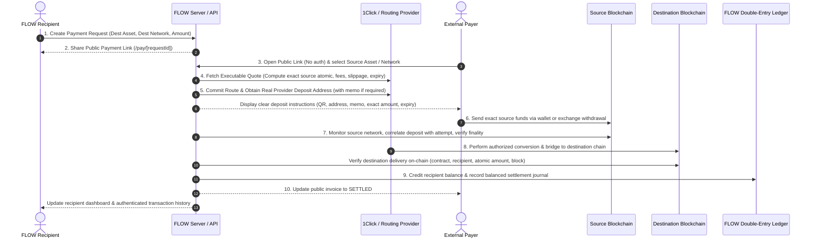

# FLOW Payment Link & Invoice Settlement Specification

**Status:** Owner Directive · Definitive Core Product Specification  
**Scope:** Payment Links, Public Invoices, 1Click Routing & Verified Multi-Chain Settlement (M5–M6)  
**Execution Guardrail:** `FLOW_EXECUTION=disabled` unconditionally enforced

---

## 1. Core Architectural Model

FLOW's core payment experience is fundamentally **asymmetric, non-custodial for the payer, and multi-chain**:

```
[ Payer ]                                                 [ Recipient ]
Unauthenticated Guest                                     Authenticated FLOW Account
Chooses ANY supported Source Asset & Network               Determines Destination Asset & Network
Uses ANY standard Wallet / Exchange                       Holds verified OutLayer-backed Custody
       │                                                         ▲
       ▼                                                         │
[ Real 1Click Deposit Address ] ──(Verified Route)──► [ FLOW Recipient Custody Address ]
```

1. **Recipient Freedom:** The recipient defines their desired destination asset and destination network (e.g. Base USDC, NEAR native, or Solana USDT), bound to their verified FLOW custody wallet.
2. **Payer Independence:** The payer independently chooses which asset and blockchain network they want to fund the payment from, selected from FLOW's catalog of verified assets and viable routes.
3. **Friction-Free Guest Payer:** The payer **must not** be required to create a FLOW account, sign in, or connect a browser wallet. The checkout interface generates unambiguous deposit instructions compatible with standard self-custody wallets (e.g. MetaMask, OKX Wallet, Phantom, Rainbow) and supported exchange withdrawals.

---

## 2. The 10-Step Payment-Link & Invoice Lifecycle



### Detailed Step Definitions

1. **Payment Request Creation:** Recipient specifies destination network, verified token contract/mint, and optional or fixed requested amount.
2. **Link Sharing:** FLOW generates an immutable, shareable public payment link (`/pay/[id]`).
3. **Source Selection:** Payer visits the link unauthenticated, browsing supported source assets and networks.
4. **Executable Quoting:** FLOW queries the routing provider (e.g., NEAR Intents 1Click) for an executable quote, establishing the exact source atomic amount, destination atomic amount, provider fees, slippage limits, and time-to-live.
5. **Invoice Attempt Commitment:** FLOW commits a unique invoice attempt record and obtains the genuine provider deposit address (and memo/tag where required).
6. **Payer Funding:** Payer sends the exact required atomic amount from their chosen wallet or exchange.
7. **Source Ingestion & Correlation:** FLOW's chain monitor tracks the source network, validates the transaction hash, confirms finality, matches the deposit address/memo, and prevents duplicate attribution.
8. **Route Execution & Destination Observation:** The routing engine completes cross-chain settlement. FLOW's independent chain indexer observes the destination network for canonical proof of receipt.
9. **Verified Crediting & Ledger Journaling:** Only after independent on-chain verification of the destination transaction is the recipient's FLOW balance credited and a balanced journal entry recorded in the double-entry ledger.
10. **State Synchronization:** Public invoice UI transitions to completed, and the recipient's authenticated account view reflects the settled transfer.

---

## 3. Essential Safeguards & Non-Negotiables

### 3.1 Deposit Address & Custody Boundary Isolation

- **No Address Confusion:** An OutLayer recipient custody address is **never** interchangeable with a NEAR Intents 1Click deposit address.
- **No Mock Addresses:** Deposit addresses must always originate from authenticated, provider-authorized quote commitments. Synthetic or simulated addresses are strictly forbidden.

### 3.2 Asset Identification by Contract / Mint

- Assets must **never** be identified by ticker symbol alone (e.g. `USDC` exists across Ethereum, Base, Solana, and NEAR with distinct contracts and decimals).
- Every asset reference must explicitly encode `(network, standard, contract_or_mint, decimals)` matching the curated catalog in `src/domain/supported-assets-catalog.ts`.

### 3.3 Strict Quote & Expiry Discipline

- Every invoice attempt has an immutable `expires_at` timestamp.
- If a deposit is detected after expiry, it must be flagged for automated refund or operator review, never routed blindly against an expired rate.

### 3.4 Discrepancy & Anomaly Handling

| Condition             | Definition                                              | Safe Handling Protocol                                                                 |
| :-------------------- | :------------------------------------------------------ | :------------------------------------------------------------------------------------- |
| **Underpayment**      | Payer sends less than quoted atomic amount.             | Hold funds; prompt payer for top-up or provide verified refund path to refund address. |
| **Overpayment**       | Payer sends more than quoted atomic amount.             | Route the requested amount; queue the surplus for refund.                              |
| **Duplicate Payment** | Two deposits detected for the same invoice attempt.     | First deposit settles invoice; second deposit triggers isolated refund workflow.       |
| **Unsupported Token** | Deposit of unquoted asset on the deposit address.       | Flag for operator review and recovery if supported by provider refund contract.        |
| **Route Failure**     | Provider fails to deliver destination asset within SLA. | Ingest provider refund on source chain; notify payer; never credit recipient.          |

### 3.5 Exchange Withdrawal Compatibility

- Exchange withdrawals often bundle transfers, omit sender signatures, or come from pooled hot wallets without direct refund return paths.
- Exchange withdrawal mode is permitted **only** when:
  1. The routing provider explicitly supports sender-independent deposit correlation via unique deposit address or memo/tag.
  2. The payer supplies an explicit self-custody refund address prior to deposit instruction disclosure.

### 3.6 Strict Separation: Source Confirmation vs. Destination Settlement

- **Source Confirmation:** Verifies that the payer has transferred funds to the provider's deposit address and reached required finality on the source chain.
- **Destination Settlement:** Verifies that the recipient's custody wallet has actually received the destination asset on the destination chain.
- **Golden Rule:** **Zero recipient crediting occurs upon source confirmation.** Crediting happens **only** after verified destination settlement.

---

## 4. Multi-Ecosystem Matrix

FLOW guarantees unified payment link abstraction across three primary ecosystems:

| Ecosystem          | Networks Supported                                                    | Standard Asset Types                  | Key Indexer / Verification Requirements                                                                                 |
| :----------------- | :-------------------------------------------------------------------- | :------------------------------------ | :---------------------------------------------------------------------------------------------------------------------- |
| **Ethereum / EVM** | Ethereum Mainnet (`1`), Base Mainnet (`8453`), Base Sepolia (`84532`) | Native ETH, ERC-20 (USDC, USDT, etc.) | Canonical block receipts, event log topic extraction (`Transfer(address,address,uint256)`), EIP-55 checksum validation. |
| **Solana**         | Solana Mainnet, Solana Devnet                                         | Native SOL, SPL Tokens (USDC, etc.)   | `jsonParsed` instruction delta parsing, ATA (Associated Token Account) resolution, Base58 public key validation.        |
| **NEAR**           | NEAR Mainnet, NEAR Testnet                                            | Native NEAR, NEP-141 Fungible Tokens  | YoctoNEAR 24-decimal precision, implicit and named account validation, receipt execution outcome status.                |

---

## 5. Milestone & Workstream Alignment

This specification governs the upcoming milestones:

- **M5:** Public Payment Request creation, guest checkout UI, dynamic route quoting, and real deposit address generation.
- **M6:** End-to-end 1Click routing integration, source confirmation, destination verification, and settlement ledger posting.

**Execution Boundary:** `FLOW_EXECUTION=disabled` remains strictly enforced. All code, schemas, and UI components built under this specification must respect the execution gate until authorized for live funds movement.
