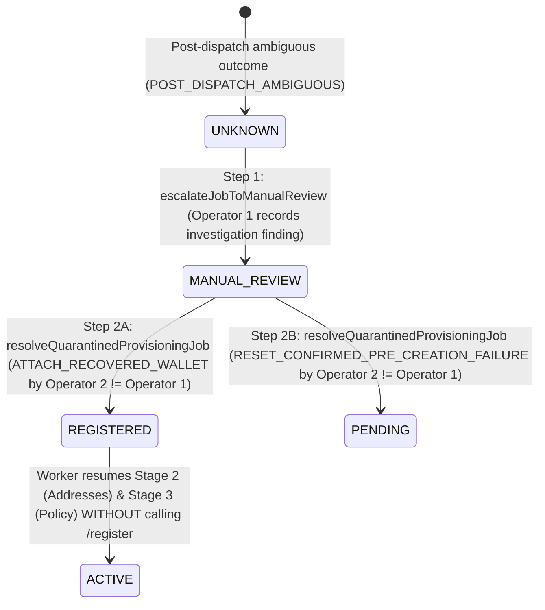

# FLOW Milestone 2 Phase 4 — OutLayer Provider Compatibility and Operational Recovery Readiness

**Date:** 7 November 2026  
**Baseline Commit Inspected:** `1e3cd71a95efced8aa19294bc7bb3148d66393c8`  
**Phase Scope:** OutLayer OpenAPI `0.1.0-alpha.4` & `@outlayer/sdk@0.1.0-alpha.4` compatibility audit, schema alignment, cryptographic public-key-to-address verification, uncertain registration quarantine hardening, two-person operator recovery workflow (`UNKNOWN` / `MANUAL_REVIEW`), credential isolation review (Web vs. Worker, PostgreSQL, Railway/Vercel), policy semantics verification, and minimal controlled real-provider compatibility test plan.  
**Live Wallet Creation / Execution Status:** Prohibited and disabled (`FLOW_EXECUTION=disabled` unconditionally enforced; zero live wallets created; zero live OutLayer authenticated requests made).

---

## 1. Executive Summary & Baseline Inspection

M2 Phase 4 began by inspecting accepted M2 Phase 3 baseline commit `1e3cd71a95efced8aa19294bc7bb3148d66393c8` and preserving all prior authentication, session, RBAC, database role separation, migration checksums, envelope encryption, durable job leasing, fencing token, and execution guard invariants.

We compared FLOW's [`OutLayerAdapter`](../../src/server/custody/outlayer-adapter.ts) and custody domain [`custody.ts`](../../src/domain/custody.ts) line-by-line against:

1. Hosted official OutLayer OpenAPI specification `https://api.outlayer.ai/openapi.json` (version `0.1.0-alpha.4`, SHA-256 `d4a948b242cdd818033adc8f667309bfc85e49a163e1f12a7f433cb0e5200a93`).
2. Official published npm package `@outlayer/sdk@0.1.0-alpha.4` (inspected offline without credentials or network execution).

### Key Discrepancies Identified & Remediated in M2 Phase 4

1. **`AddressResponse.executor_account_id` Nullability on Non-NEAR Chains:**
   - **Documented OpenAPI `0.1.0-alpha.4` Contract:** `AddressResponse.executor_account_id` has schema `type: ["string", "null"]` — it equals `address` on `chain=near` and is `null` on non-NEAR chains (`base`, `solana`, `ethereum`, etc.).
   - **Previous Adapter Behavior:** `z.string().optional()` rejected `null` with a schema mismatch error.
   - **Remediation:** Updated `addressResponseSchema` in [`src/server/custody/outlayer-adapter.ts`](../../src/server/custody/outlayer-adapter.ts) to `z.string().nullable().optional()`, added optional `vault_id`, `sub_path`, and `gas_balance` fields from OpenAPI `0.1.0-alpha.4`, and added a mandatory correlation check in `getAddress()` verifying that when `chain === "near"` and `executor_account_id` is non-null, `executor_account_id === address`.
2. **Cryptographic Public-Key-to-Address Consistency Verification:**
   - **Previous Behavior:** Validated address syntax (`isValidNearAddress`, `isValidEvmAddress`, `isValidSolanaAddress`) and checked that `public_key` was non-empty, but did not verify that `public_key` cryptographically derives to `address`.
   - **Remediation:** Implemented [`deriveEvmAddressFromSecp256k1PublicKey`](../../src/domain/custody.ts) (verifying the `secp256k1` curve equation $y^2 \equiv x^3 + 7 \pmod p$, decompressing 33-byte `0x02`/`0x03` compressed keys via modular square root $y = (x^3 + 7)^{(p+1)/4} \bmod p$, validating 64/65-byte uncompressed keys, and computing Keccak-256 -> EIP-55 address) and [`verifyPublicKeyMatchesAddress`](../../src/domain/custody.ts) across `near` (32-byte Ed25519 key <-> 64-hex implicit address), `base`/`ethereum` (`secp256k1` point <-> 20-byte EVM address), and `solana` (32-byte Ed25519 key <-> 32-byte Base58 address). Enforced strictly (`strict: true`) in [`OutLayerAdapter.getAddress`](../../src/server/custody/outlayer-adapter.ts).
3. **Uncertain Post-Dispatch Registration Quarantine (`HTTP 200` Corrupted Body / Schema Mismatch / Invalid Address):**
   - **Previous Behavior:** `isAmbiguousRegistrationError` quarantined timeouts (`CUSTODY_PROVIDER_TIMEOUT`), network errors (`CUSTODY_PROVIDER_NETWORK_ERROR`), and `5xx` (`CUSTODY_PROVIDER_UNAVAILABLE`), but if `POST /register` returned HTTP 200 with truncated JSON, a schema mismatch, or a malformed `near_account_id`, or returned HTTP `408`/`409`/`425`, the error could be classified as non-ambiguous. Because an HTTP 200 response from `POST /register` means OutLayer likely created the wallet before the response payload was corrupted in transit, retrying would create a duplicate anonymous wallet.
   - **Remediation:** Hardened [`classifyProviderError`](../../src/server/custody/outlayer-adapter.ts) (`408`/`504` -> `CUSTODY_PROVIDER_TIMEOUT`, `409`/`425`/`5xx` -> `CUSTODY_PROVIDER_UNAVAILABLE`) and [`isAmbiguousRegistrationError`](../../src/server/custody/provisioning-worker.ts) so that **any** post-dispatch registration failure whose remote side effects are uncertain (including HTTP 200 invalid JSON, schema mismatch, or invalid NEAR address on `/register`) transitions the job into `UNKNOWN` (`POST_DISPATCH_AMBIGUOUS`) and blocks automatic retry.
4. **OutLayer `PolicyResponse` Semantics vs. Local Adapter Provenance Guard:**
   - **Remediation:** Documented and enforced the exact distinction between FLOW's in-process software boundary guard (`ADAPTER_POLICY_BRAND` in [`mintTrustedAdapterPolicyEvidence`](../../src/domain/custody.ts), which prevents internal callers from passing raw strings or unvalidated object literals) and OutLayer's documented `PolicyResponse` contract (`rules.transaction_types`, `rules.limits`, `capabilities.raw_sign`, `capabilities.evm_sign`, `capabilities.solana_sign`, `capabilities.swap`, `capabilities.cross_chain_withdraw`, `capabilities.limit_order`, `capabilities.payment_check`, `capabilities.confidential`, and omitted `policy` when the chain is unreadable).
5. **Operator-Only Two-Person Recovery Workflow for `UNKNOWN` and `MANUAL_REVIEW` Jobs:**
   - **Remediation:** Implemented [`escalateJobToManualReview`](../../src/server/custody/job-repository.ts) and [`resolveQuarantinedProvisioningJob`](../../src/server/custody/job-repository.ts) (`ATTACH_RECOVERED_WALLET` and `RESET_CONFIRMED_PRE_CREATION_FAILURE`) enforcing two-person operator approval (`initiatorOperatorAuthId !== approverOperatorAuthId`), account ownership and kind (`PERSONAL` vs. `BUSINESS`) verification, `dispatch_attempt_id` correlation, duplicate/unrelated wallet attachment prevention, cryptographic NEAR public-key-to-address verification, allowlisted `recovery_evidence` persistence, and append-only `flow.security_audit_events` logging.

---

## 2. OutLayer Provider Compatibility Matrix

comparison against OutLayer OpenAPI `0.1.0-alpha.4` (`https://api.outlayer.ai/openapi.json`) and `@outlayer/sdk@0.1.0-alpha.4`:

| Capability / Surface                                                                                             | Official OpenAPI `0.1.0-alpha.4` & `@outlayer/sdk` Contract                                                                                                                                                                                                                                                           | FLOW Adapter / Domain Implementation                                                                                                                                                                                                                                                                   | Evidence Status                                       | Notes / Verification                                                                                                                                                                   |
| ---------------------------------------------------------------------------------------------------------------- | --------------------------------------------------------------------------------------------------------------------------------------------------------------------------------------------------------------------------------------------------------------------------------------------------------------------- | ------------------------------------------------------------------------------------------------------------------------------------------------------------------------------------------------------------------------------------------------------------------------------------------------------ | ----------------------------------------------------- | -------------------------------------------------------------------------------------------------------------------------------------------------------------------------------------- |
| **Base API Endpoints**                                                                                           | OpenAPI server: `https://api.outlayer.ai`. `@outlayer/sdk` defaults: `https://api.outlayer.fastnear.com` (mainnet), `https://api.testnet.outlayer.fastnear.com` (testnet).                                                                                                                                            | Configurable via `OUTLAYER_API_URL` (`https://` enforced outside loopback test fixtures; blocked while `FLOW_EXECUTION=disabled`).                                                                                                                                                                     | **Documented & Verified Offline**                     | Confirm canonical production hostname (`api.outlayer.ai` vs `api.outlayer.fastnear.com`) in live compatibility check.                                                                  |
| **Anonymous Registration (`POST /register`)**                                                                    | Request: `{}` (`RegisterRequest`, all fields optional). Response `200`: `{ wallet_id, api_key: "wk_...", near_account_id: "<64-hex>", handoff_url, trial?: { limit, used, remaining } }`. No idempotency key header supported.                                                                                        | `OutLayerAdapter.register({})` validates UUID `wallet_id`, `wk_` bearer key, 64-hex/named `near_account_id`, optional `trial`, and scrubs `key=` from `handoff_url`.                                                                                                                                   | **Documented & Verified Offline**                     | Single-shot non-idempotent call; stage-1 atomic DB commit immediately persists encrypted `api_key`.                                                                                    |
| **Deterministic Registration (`POST /register`)**                                                                | Request: `{ account_id, pubkey, message, signature, seed?, vault_id? }` where `message = "outlayer-wallet-auth:{account_id}:{seed_hex}:{vault_id}:{timestamp_ns}"` signed within 5 minutes by `pubkey` (verified via NEAR RPC `view_access_key`).                                                                     | Supported in `RegisterWalletOptions` (`account_id`, `pubkey`, `message`, `signature`, `seed`, `vault_id`).                                                                                                                                                                                             | **Documented (Unconfirmed Live)**                     | Requires a funded NEAR controller account whose access key is registered on-chain so OutLayer coordinator can verify `view_access_key`.                                                |
| **Address Derivation (`GET /wallet/v1/address`)**                                                                | Query: `chain` (`near`, `ethereum`, `bitcoin`, `solana`, `arbitrum`, `base`, `optimism`, `polygon`, `avalanche`, `bsc`, `hyperevm`, `hood`), optional `index`, `type`. Response: `{ wallet_id, chain, address, public_key, derivation_path, executor_account_id: string \| null, vault_id, sub_path, gas_balance? }`. | `OutLayerAdapter.getAddress` validates `wallet_id` correlation, `chain` correlation, `executor_account_id` correlation on NEAR (`null` accepted on Base/Solana), address format, and strict cryptographic `public_key` -> `address` consistency.                                                       | **Documented & Verified Offline**                     | `bitcoin` is intentionally blocked in FLOW (`UNSUPPORTED_CHAIN`). Launch chains `near`, `base`, `solana` are cryptographically verified.                                               |
| **Custody Policy Inspection (`GET /wallet/v1/policy`)**                                                          | Response `200`: `{ wallet_id, controller, frozen, policy?: "stored" \| "none", rules?: PolicyRules, approval?: ApprovalConfig, capabilities?: Capabilities, authorized_key_hashes?, refund_addresses?, usage? }`. `policy` omitted if chain is unreadable.                                                            | `OutLayerAdapter.getPolicy` validates schema + `wallet_id` correlation and mints internal adapter boundary provenance. `verifyCustodyPolicyEvidence` requires `frozen === false`, `policy === "stored"`, valid NEAR `controller`, and zero fund-moving rules/capabilities while execution is disabled. | **Documented & Verified Offline**                     | Newly registered anonymous wallets have `policy: "none"` (unrestricted in OutLayer) until `store_wallet_policy` is executed on-chain.                                                  |
| **Policy Encryption & Signing (`POST /wallet/v1/encrypt-policy`, `POST /wallet/v1/sign-policy`)**                | `encrypt-policy` encrypts JSON policy via MPC CKD (`ciphertext`, `policy_hash`). `sign-policy` signs `store_wallet_policy` / `freeze_wallet` args for controller submission to `controller.outlayer.near` or `vault.outlayer.near`.                                                                                   | Documented in M2 architecture; not invoked during M2 read-only provisioning because live on-chain controller transactions are prohibited in M2.                                                                                                                                                        | **Documented (Unconfirmed Live)**                     | Must be tested in future owner-approved live compatibility session to transition a live wallet from `policy: "none"` to `policy: "stored"`.                                            |
| **Credential Rotation & Stateless Auth (`POST /wallet/v1/auth-sign`, `PUT /wallet/v1/api-key`, `Bearer near:`)** | `POST /wallet/v1/auth-sign` constructs the NEP-413 payload. `PUT /wallet/v1/api-key` (referenced in OpenAPI prose) rotates `wk_...` for deterministic wallets without changing `wallet_id` or derived addresses. `Bearer near:<base64url>` allows stateless per-request auth.                                         | Local envelope rotation (`rotateEnvelope` with `key_id` + `key_digest`) is implemented in `crypto-envelope.ts`. Provider-side `PUT /wallet/v1/api-key` is documented for deterministic wallets.                                                                                                        | **Partially Documented (Requires Live Confirmation)** | `PUT /wallet/v1/api-key` is described in `/register` and `/wallet/v1/auth-sign` descriptions in `openapi.json`, but is omitted from the `paths` map of `openapi.json` `0.1.0-alpha.4`. |
| **Provider Error Envelope (`ErrorResponse`)**                                                                    | `{ error: string, code: ErrorCode, details?: object }` where `ErrorCode` is an enum of 16 codes (`unauthorized`, `invalid_request`, `policy_denied`, `wallet_frozen`, `spending_limit_exceeded`, `rate_limited`, `internal_error`, `mpc_error`, `chain_rpc_error`, etc.).                                             | `OutLayerAdapter.request` never echoes upstream `error` or `details` strings into FLOW errors or DB columns; maps status codes to fixed internal `FlowErrorCode` classifications.                                                                                                                      | **Documented & Verified Offline**                     | Hostile upstream bodies (HTML, JWTs, `wk_` keys, cookies, DB URLs) are completely isolated and dropped.                                                                                |

---

## 3. Request & Response Contract Verification

### 3.1 Wallet Registration (`POST /register`)

- **Request (`RegisterRequest`):**
  - Anonymous mode: `{}` (no `Authorization` header required).
  - Deterministic mode: `{ account_id, pubkey, message, signature, seed?, vault_id? }`.
- **Response (`RegisterResponse`):**
  - `wallet_id` (`string`, UUID): e.g., `"9c3c9e10-1c1f-4f5e-9c4a-1d7b9a8f3c20"`.
  - `api_key` (`string`, `^wk_[0-9a-f]{32,64}$`): 67-char hex-encoded bearer key in production (`wk_` + 64 hex chars); FLOW accepts 32–64 hex chars to support both live 64-hex keys and test fixtures.
  - `near_account_id` (`string`): 64-char hex implicit NEAR account ID derived from MPC key.
  - `handoff_url` (`string`): URL containing `?key=wk_...` query parameter; FLOW immediately strips `key`, `api_key`, `token`, and `secret` query parameters and hash fragments via [`scrubHandoffUrl`](../../src/server/custody/outlayer-adapter.ts) before persisting `handoff_url`.
  - `trial` (`TrialInfo`, optional): `{ limit, used, remaining }` gasless trial quota.

### 3.2 Chain Address Derivation (`GET /wallet/v1/address?chain={near|base|solana}`)

- **Authentication:** `Authorization: Bearer wk_...` (or `Authorization: Bearer near:<base64url>`).
- **Query Parameters:** `chain` (`near`, `base`, `solana`), optional `index` (default `0`), optional `type` (`receive`, `change`, `intents`).
- **Response (`AddressResponse`):**
  - `wallet_id` (`string`): Must strictly equal the expected `provider_wallet_id` persisted in Stage 1 (`CUSTODY_PROVIDER_CORRELATION_ERROR` on mismatch).
  - `chain` (`string`): Must strictly equal the requested `chain` (`CUSTODY_PROVIDER_CORRELATION_ERROR` on mismatch).
  - `address` (`string`):
    - `near`: 64-character lowercase hex implicit account ID (equal to the hex encoding of the 32-byte Ed25519 public key).
    - `base`: `0x`-prefixed 40-hex EVM address with EIP-55 Keccak-256 checksum (equal to the last 20 bytes of `Keccak256(uncompressed_secp256k1_pubkey_64_bytes)`).
    - `solana`: 32–44 char Base58 string decoding to a non-zero 32-byte Ed25519 public key.
  - `public_key` (`string`): Curve-prefixed public key (`ed25519:...` on NEAR/Solana, `secp256k1:...` on Base/EVM). Verified cryptographically against `address` via [`verifyPublicKeyMatchesAddress`](../../src/domain/custody.ts).
  - `derivation_path` (`string`): MPC CKD derivation path (e.g., `"near,0,0"`, `"evm,8453,0"`, `"solana,0,0"`).
  - `executor_account_id` (`string | null`): Equal to `address` on `chain=near`; `null` on `base` and `solana`.

### 3.3 Custody Policy Inspection (`GET /wallet/v1/policy`)

- **Response (`PolicyResponse`):**
  - `wallet_id` (`string`): Must equal expected `provider_wallet_id`.
  - `controller` (`string`): NEAR account ID of the wallet controller.
  - `frozen` (`boolean`): Whether the wallet is frozen on-chain.
  - `policy` (`"stored" | "none" | undefined`): `"stored"` when an encrypted policy is stored on-chain; `"none"` when no policy is stored (OutLayer treats `"none"` as unrestricted); `undefined` when OutLayer's coordinator cannot read or decrypt the on-chain state.
  - `rules` (`PolicyRules`): `{ transaction_types?, allowed_tokens?, addresses?, limits?, time_restrictions?, rate_limit? }`.
  - `capabilities` (`Capabilities`): `{ raw_sign?, evm_sign?, solana_sign?, swap?, cross_chain_withdraw?, limit_order?, payment_check?, confidential?, sign_message? }`.

---

## 4. Anonymous vs. Deterministic Wallet Registration Evaluation

OutLayer `POST /register` supports two distinct registration modes. Below is the architectural evaluation for FLOW's personal and business accounts:

| Dimension                                         | Anonymous Registration (`POST /register` with `{}`)                                                                                                                                              | Deterministic Registration (`POST /register` with NEAR Signature + `seed` + `vault_id`)                                                                                                                                                                                                                                                   |
| ------------------------------------------------- | ------------------------------------------------------------------------------------------------------------------------------------------------------------------------------------------------ | ----------------------------------------------------------------------------------------------------------------------------------------------------------------------------------------------------------------------------------------------------------------------------------------------------------------------------------------- |
| **Identity Derivation**                           | Random UUID `wallet_id` generated by OutLayer coordinator (`sub_path = wallet_id`).                                                                                                              | Deterministic `wallet_id` derived from `(account_id, seed, vault_id)` (`sub_path = "{vault_id}:{seed}"`).                                                                                                                                                                                                                                 |
| **Prerequisites**                                 | None — zero on-chain setup required before registration call.                                                                                                                                    | Requires a funded NEAR controller account (`account_id`) whose Ed25519 access key (`pubkey`) is already confirmed on-chain (verified by OutLayer via NEAR RPC `view_access_key`) and signs a NEP-413 message within a 5-minute window.                                                                                                    |
| **Lost-Response / Retry Safety**                  | **Non-idempotent.** Repeating `POST /register {}` after a lost HTTP 200 response creates a second, orphan wallet with different addresses. Requires strict post-dispatch quarantine (`UNKNOWN`). | **Idempotent by `(account_id, seed, vault_id)`.** However, OpenAPI `0.1.0-alpha.4` documents that if a deterministic wallet is already registered, callers use `PUT /wallet/v1/api-key` or `Bearer near:<token>` rather than re-issuing `POST /register`.                                                                                 |
| **Credential Recovery & Rotation**                | If the one-time `wk_...` API key is lost before persistence, the wallet cannot be recovered via API key rotation unless a controller policy was already bound.                                   | Controller can rotate `wk_...` at any time via `PUT /wallet/v1/api-key` using a fresh NEP-413 signature from `account_id`, or authenticate statelessly per request via `Authorization: Bearer near:<base64url>`.                                                                                                                          |
| **Per-Account Isolation (Personal vs. Business)** | Each FLOW account (`PERSONAL` or `BUSINESS`) receives an independent random `wallet_id` and independent `wk_...` bearer key.                                                                     | Each FLOW account derives an isolated wallet using a canonical, immutable per-account seed (`seed = "flow:v1:account:{account_id}"`) and environment-scoped `vault_id`, controlled by FLOW's environment-isolated NEAR controller account (`controllerAccountId`), while keeping separate database records and per-account `wk_...` keys. |
| **Custody & Policy Configuration**                | Starts with `policy: "none"` and requires `store_wallet_policy` to bind a controller and restrict operations.                                                                                    | Binds `controller = account_id` from registration, enabling immediate controller-signed `store_wallet_policy` and `freeze_wallet` governance.                                                                                                                                                                                             |

### Recommended Long-Term Strategy for Personal and Business Accounts

1. **Target Production Architecture (Deterministic Registration per Account with Separate Personal/Business Seeds):**
   - Once FLOW provisions an environment-specific NEAR controller account (`flow-controller.near` / testnet equivalent) in an owner-approved live setup session, **deterministic registration** with `seed = "flow:v1:{account_kind}:{flow_account_id}"` and `vault_id` is the safest long-term production model for both **personal** and **business** accounts:
     - Every personal account and every business account gets a cryptographically separate wallet identity (`wallet_id`, `near_account_id`, Base address, Solana address) because `flow_account_id` is a unique UUID per account.
     - If a network drop occurs during `POST /register`, the deterministic `(account_id, seed, vault_id)` tuple prevents orphan wallet proliferation and allows credential recovery via `PUT /wallet/v1/api-key` or stateless `Bearer near:<base64url>` authentication.
2. **Defense-in-Depth Quarantine Retained Unconditionally:**
   - Even when deterministic registration is enabled in production, FLOW **retains** the Stage 1 immediate credential commit and post-dispatch `UNKNOWN` quarantine (`POST_DISPATCH_AMBIGUOUS`) so that no worker ever loops or blindly re-dispatches an ambiguous registration without operator verification.

---

## 5. Registration Failure Classification & Quarantine Audit

We reviewed every error path reachable during `POST /register` in [`OutLayerAdapter.register`](../../src/server/custody/outlayer-adapter.ts) and [`WalletProvisioningWorker.executeJobWithLease`](../../src/server/custody/provisioning-worker.ts):

| Failure Scenario During `POST /register`                                | Adapter Error Code                                 | `isAmbiguousRegistrationError` | Worker Transition                                            | Auto-Retry Permitted?     | Rationale                                                                   |
| ----------------------------------------------------------------------- | -------------------------------------------------- | ------------------------------ | ------------------------------------------------------------ | ------------------------- | --------------------------------------------------------------------------- |
| Failure **before** `recordJobDispatch` (DB lease/config error)          | `INVALID_CONFIGURATION` / `JOB_LEASE_EXPIRED`      | `false` (pre-dispatch)         | Remains `PENDING` / `LEASED`                                 | Yes (safe pre-dispatch)   | External network request was never sent.                                    |
| Request timeout (`AbortError` / `TimeoutError`) or HTTP `408` / `504`   | `CUSTODY_PROVIDER_TIMEOUT`                         | **`true`**                     | **`UNKNOWN` (`POST_DISPATCH_AMBIGUOUS`)**                    | **NO (Quarantined)**      | OutLayer may have created the wallet before timeout.                        |
| TCP reset / DNS / TLS / socket drop in flight                           | `CUSTODY_PROVIDER_NETWORK_ERROR`                   | **`true`**                     | **`UNKNOWN` (`POST_DISPATCH_AMBIGUOUS`)**                    | **NO (Quarantined)**      | Request may have reached OutLayer coordinator before socket drop.           |
| HTTP `409 Conflict`, `425 Too Early`, or `500`/`502`/`503`              | `CUSTODY_PROVIDER_UNAVAILABLE`                     | **`true`**                     | **`UNKNOWN` (`POST_DISPATCH_AMBIGUOUS`)**                    | **NO (Quarantined)**      | Upstream proxy or coordinator may have committed wallet state.              |
| HTTP `200 OK` with truncated/invalid JSON body                          | `CUSTODY_PROVIDER_ERROR` (`Invalid JSON...`)       | **`true`**                     | **`UNKNOWN` (`POST_DISPATCH_AMBIGUOUS`)**                    | **NO (Quarantined)**      | HTTP 200 indicates wallet was created, but `api_key` was lost in transit.   |
| HTTP `200 OK` failing `registerResponseSchema`                          | `CUSTODY_PROVIDER_ERROR` (`schema mismatch...`)    | **`true`**                     | **`UNKNOWN` (`POST_DISPATCH_AMBIGUOUS`)**                    | **NO (Quarantined)**      | HTTP 200 indicates wallet creation occurred with unexpected response shape. |
| HTTP `200 OK` with invalid `near_account_id`                            | `CUSTODY_INVALID_ADDRESS`                          | **`true`**                     | **`UNKNOWN` (`POST_DISPATCH_AMBIGUOUS`)**                    | **NO (Quarantined)**      | Remote side effect occurred; requires manual inspection.                    |
| Worker process crash after `recordJobDispatch` before Stage 1 DB commit | Detected by `reconcileCrashedJobs` on lease expiry | **`true`**                     | **`UNKNOWN` (`POST_DISPATCH_AMBIGUOUS`)**                    | **NO (Quarantined)**      | In-flight crash leaves remote creation outcome uncertain.                   |
| HTTP `429 Too Many Requests`                                            | `CUSTODY_PROVIDER_RATE_LIMITED`                    | `false`                        | `PENDING` (exponential backoff) or `FAILED` (`RATE_LIMITED`) | Yes (up to `maxAttempts`) | Request rejected at rate-limiter before registration execution.             |
| HTTP `400 Bad Request` / `401` / `403` / `404` / `422`                  | `CUSTODY_PROVIDER_ERROR`                           | `false`                        | `FAILED` (`PROVIDER_VALIDATION_ERROR`)                       | No (terminal failure)     | Deterministic pre-creation request rejection.                               |

---

## 6. Operator-Only Recovery Workflow for `UNKNOWN` and `MANUAL_REVIEW` Jobs

Quarantined jobs in `UNKNOWN` cannot be claimed by `claimJobLease` or `claimNextPendingJobs`. In [`src/server/custody/job-repository.ts`](../../src/server/custody/job-repository.ts), we implemented a two-step, operator-only recovery workflow with two-person approval and append-only security audit logging:

### Step 1: Escalation & Evidence Collection (`escalateJobToManualReview`)

- **Inputs:** `jobId`, `accountId`, optional `expectedAccountKind` (`PERSONAL` | `BUSINESS`), `operatorAuthId`, `reasonCode` (allowlisted enum: `AMBIGUOUS_REGISTRATION_OUTCOME`, `CORRUPTED_PROVIDER_RESPONSE`, `POLICY_VERIFICATION_ESCALATION`, `OPERATOR_SECURITY_HOLD`), `providerInspectionSummary` (allowlisted enum: `NO_REMOTE_WALLET_FOUND`, `REMOTE_WALLET_LOCATED`, `PROVIDER_AUDIT_PENDING`), optional `expectedDispatchAttemptId`, and UUID `requestId`.
- **Protections:**
  1. Acquires `FOR UPDATE` row lock on `flow.wallet_provisioning_jobs`.
  2. Verifies `job.account_id === accountId`, optional `account.kind === expectedAccountKind`, `job.status IN ('UNKNOWN', 'FAILED')`, and `job.dispatch_attempt_id === expectedDispatchAttemptId`.
  3. Increments `fencing_token`, clears any lease fields, transitions status to `MANUAL_REVIEW`, and writes allowlisted JSON metadata to `recovery_evidence`.
  4. Appends an immutable `wallet_recovery_escalated` record to `flow.security_audit_events`.

### Step 2: Two-Person Approved Resolution (`resolveQuarantinedProvisioningJob`)

- **Mandatory Two-Person Control (`TWO_PERSON_APPROVAL_REQUIRED`):**
  - Requires `initiatorOperatorAuthId` and `approverOperatorAuthId` to be valid, distinct operator identities (`initiator.toLowerCase() !== approver.toLowerCase()`).
  - Also cross-checks the persisted `recovery_evidence.initiatorOperatorAuthId` from Step 1 to guarantee that the operator approving Step 2 is not the operator who initiated Step 1.
- **Account Ownership, Account Kind, & Unrelated Wallet Protection (`WALLET_ACCOUNT_MISMATCH`):**
  - Verifies `flow.accounts.id === input.accountId` and `flow.accounts.kind === input.expectedAccountKind` (`PERSONAL` vs. `BUSINESS`), preventing a personal wallet recovery from being applied to a business account or vice versa.
  - Verifies `job.dispatch_attempt_id === input.expectedDispatchAttemptId`.
  - For `ATTACH_RECOVERED_WALLET`: queries `flow.wallets` to ensure that neither `account_id`, nor `provider_wallet_id`, nor `lower(near_account_id)` is already bound to any wallet record, preventing an operator from attaching another account's wallet.
  - Cryptographically verifies `verifyPublicKeyMatchesAddress("near", nearAccountId, nearPublicKey, { strict: true })` before inserting the recovered wallet in `SETUP_PENDING` (`policy_state = 'none'`) and advancing the job to `REGISTERED` (Stage 1 complete). The worker then resumes Stage 2 (address derivation) and Stage 3 (policy verification) without calling `POST /register`.
  - For `RESET_CONFIRMED_PRE_CREATION_FAILURE`: requires that the job was escalated to `MANUAL_REVIEW` with `providerInspectionSummary === "NO_REMOTE_WALLET_FOUND"` and that zero wallet rows exist for `account_id` before resetting the job to `PENDING`.
  - Appends two immutable events (`wallet_recovery_initiated` and `wallet_recovery_approved_attach` / `wallet_recovery_approved_reset`) to `flow.security_audit_events`.

---

## 7. Credential Isolation Review: Web Process vs. Provisioning Worker, Database Permissions, and Future Railway/Vercel Secret Architecture

### 7.1 Current Local & CI Isolation Guarantees

1. **Query Projection Isolation:**
   - All web-facing queries ([`getAccountWalletPublicProjection`](../../src/server/custody/job-repository.ts)) explicitly `SELECT` only non-sensitive metadata columns (`id`, `account_id`, `provider`, `provider_wallet_id`, `near_account_id`, `status`, `policy_state`, `controller_account_id`, `handoff_url`) and **never** select `encrypted_credential`, `key_id`, or `key_digest`.
2. **Envelope Encryption with Key Separation:**
   - `flow.wallets.encrypted_credential` stores versioned `v1:` AES-256-GCM envelopes (`FLOW_WALLET_ENCRYPTION_KEY`, 32-byte hex key with 96-bit random IV, 128-bit auth tag, and `key_digest` SHA-256 binding).
   - [`wallet-environment.ts`](../../src/foundation/wallet-environment.ts) enforces that `FLOW_WALLET_ENCRYPTION_KEY` is cryptographically distinct from `BETTER_AUTH_SECRET` and `FLOW_AUTH_OTP_HASH_KEY`.
3. **Database Role Restrictions (`flow_*_app` vs. `flow_*_migrator`):**
   - `flow_*_app` cannot `DELETE` from `flow.wallets`, `flow.wallet_addresses`, `flow.wallet_capabilities`, or `flow.wallet_provisioning_jobs`, and has `INSERT`-only access on `flow.security_audit_events` (`SELECT`/`UPDATE`/`DELETE` denied).

### 7.2 Architectural Gap Identified & Target Railway/Vercel Production Split

- **Current Shared Role Observation:** In the current local/test setup, the Next.js web server and `WalletProvisioningWorker` connect using the same `flow_*_app` PostgreSQL role. Because `flow_*_app` needs `SELECT encrypted_credential` for Stage 2/3 worker resumption, a SQL injection or compromise in the web process could theoretically query `flow.wallets.encrypted_credential` (though it would still be encrypted under `FLOW_WALLET_ENCRYPTION_KEY`).
- **Production Isolation Architecture for Railway (Worker) and Vercel (Web):**
  1. **Process & Secret Separation:**
     - **Vercel (Next.js Web Process):** Does **not** receive `FLOW_WALLET_ENCRYPTION_KEY` in its environment variables. Even if the web process were compromised, it cannot decrypt any `v1:` credential envelope. The web process only enqueues `PENDING` rows in `flow.wallet_provisioning_jobs` and reads [`getAccountWalletPublicProjection`](../../src/server/custody/job-repository.ts).
     - **Railway (Provisioning Worker Process):** Runs [`WalletProvisioningWorker`](../../src/server/custody/provisioning-worker.ts) in an isolated backend service that holds `FLOW_WALLET_ENCRYPTION_KEY` (and, in future KMS migration, IAM credentials to unwrap envelope DEKs via Cloud KMS / AWS KMS).
  2. **PostgreSQL Role Split (Pre-Production Migration Gate):**
     - Split `flow_*_app` into `flow_*_web_app` (granted `SELECT` only on non-credential columns of `flow.wallets` via column-level privileges `GRANT SELECT (id, account_id, provider, provider_wallet_id, near_account_id, status, policy_state, controller_account_id, handoff_url, created_at, updated_at) ON flow.wallets TO flow_prod_web_app`) and `flow_*_worker_app` (granted full `SELECT, INSERT, UPDATE` on `flow.wallets` and `flow.wallet_provisioning_jobs`).

---

## 8. Chain-Specific Address Validation & Cryptographic Public-Key Consistency

In [`src/domain/custody.ts`](../../src/domain/custody.ts), we implemented pure, deterministic cryptographic public-key-to-address verification in [`verifyPublicKeyMatchesAddress`](../../src/domain/custody.ts) and [`deriveEvmAddressFromSecp256k1PublicKey`](../../src/domain/custody.ts):

1. **NEAR (`near` / `near:mainnet`):**
   - Rejects any `secp256k1:`-prefixed public key.
   - Decodes `ed25519:<base58>` or `ed25519:<64-hex>` to its 32-byte raw Ed25519 public key (rejecting all-zero keys).
   - For 64-hex implicit accounts (the format returned by OutLayer `POST /register` and `GET /wallet/v1/address?chain=near`), verifies that `hex(ed25519_pubkey_bytes) === address.toLowerCase()`.
2. **Base & Ethereum (`base` / `eip155:8453` / `ethereum` / `eip155:1`):**
   - Rejects any `ed25519:`-prefixed public key.
   - Parses `secp256k1:` public keys in 33-byte compressed (`0x02`/`0x03` + $x$), 65-byte uncompressed (`0x04` + $x$ + $y$), or 64-byte raw ($x \parallel y$) hex/Base58 encoding.
   - Verifies that the point $(x, y)$ lies on the `secp256k1` curve $y^2 \equiv x^3 + 7 \pmod p$ where $p = 2^{256} - 2^{32} - 977$ (and decompresses 33-byte keys using $y = (x^3 + 7)^{(p+1)/4} \bmod p$ with parity matching prefix `0x02`/`0x03`).
   - Computes `Keccak-256(x || y)` (64 bytes), takes the last 20 bytes, formats the EIP-55 checksum address, and verifies exact equality with `address`.
3. **Solana (`solana` / `solana:mainnet`):**
   - Rejects any `secp256k1:`-prefixed public key.
   - Decodes both `public_key` (`ed25519:<base58>`) and `address` (`<base58>`) to 32-byte buffers and verifies byte-for-byte equality (`Buffer.compare(keyBytes, addrBytes) === 0`).

---

## 9. Custody Policy Evidence Verification vs. Local Adapter Provenance

We audited [`mintTrustedAdapterPolicyEvidence`](../../src/domain/custody.ts) and [`verifyCustodyPolicyEvidence`](../../src/domain/custody.ts) against OutLayer's `PolicyResponse` contract:

1. **What `ADAPTER_POLICY_BRAND` Is (and Is Not):**
   - `ADAPTER_POLICY_BRAND` is an **in-process software boundary guard** (an unenumerable `Symbol` carrying an HMAC-SHA256 over the canonical policy fields using an ephemeral per-process key). It prevents application callers from bypassing `OutLayerAdapter.getPolicy()` with raw strings (`"stored"`) or fabricated object literals.
   - It is **not** a remote TEE hardware quote from OutLayer (`GET /wallet/v1/policy` returns standard JSON over TLS; OutLayer's cryptographic policy integrity is enforced inside the TEE enclave when `store_wallet_policy` is submitted to `controller.outlayer.near` / `vault.outlayer.near` using `POST /wallet/v1/encrypt-policy` and `POST /wallet/v1/sign-policy`).
2. **Alignment with OutLayer OpenAPI `0.1.0-alpha.4` `PolicyResponse`:**
   - OutLayer `GET /wallet/v1/policy` returns `{ wallet_id, controller, frozen, policy?, rules?, approval?, capabilities?, authorized_key_hashes?, refund_addresses?, usage? }`.
   - When `policy` is `"none"`, OutLayer allows all operations without restriction. When `policy` is omitted (`undefined`), the coordinator could not read or decrypt the on-chain policy. [`verifyCustodyPolicyEvidence`](../../src/domain/custody.ts) strictly rejects both `"none"` and `undefined`, requiring `policy === "stored"` and `frozen === false`.
   - In OutLayer `PolicyRules`, omitting `transaction_types` allows all operation types. Therefore, while `FLOW_EXECUTION=disabled`, [`verifyCustodyPolicyEvidence`](../../src/domain/custody.ts) requires explicit default-deny evidence (`rules.defaultAction === "DENY"` or `rules.transaction_types: []` / zero-spend limits `limits.per_transaction["*"] === "0"`) and rejects any response where `rules.transaction_types` contains a fund-moving operation (`transfer`, `withdraw`, `cross_chain_withdraw`, `swap`, `limit_order`, `payment_check`, `confidential`, `near_call`, `raw_sign`, `evm_sign`, `solana_sign`) or where any corresponding entry in `capabilities` is enabled (`true` or `{ allowed: true }` / `{ raw_tx: true }`).

---

## 10. Minimal Controlled Real-Provider Compatibility Test Plan (Future Owner-Approved Session)

No live OutLayer calls or wallet registrations were performed in M2 Phase 4. Below is the minimal, controlled compatibility test plan for a future owner-approved session:

### 10.1 Cost, Prerequisites, and Irreversible Effects of Live Registration

- **Direct Financial Cost of `POST /register`:**
  - **Anonymous `POST /register {}`:** Free ($0 / 0 NEAR) HTTP call. OutLayer allocates an internal `wallet_id`, derives an implicit 64-hex NEAR account ID (which is **not** funded on-chain until assets are sent to it), and returns a `TrialInfo` gasless signature quota (`trial: { limit, used, remaining }`).
  - **Deterministic `POST /register` & On-Chain Policy Storage (`store_wallet_policy`):** Requires a funded NEAR controller account (`controllerAccountId`) because OutLayer verifies the controller's access key via NEAR RPC `view_access_key` and because calling `store_wallet_policy` on `controller.outlayer.near` / `vault.outlayer.near` requires a small NEAR gas fee + storage deposit on NEAR mainnet/testnet.
- **Irreversible Effects:**
  - Each `POST /register` call permanently allocates a `wallet_id` record in OutLayer's coordinator database and consumes 1 registration against IP/account rate limits.
  - Calling `store_wallet_policy` writes an encrypted policy blob to the NEAR blockchain.

### 10.2 Step-by-Step Controlled Live Rehearsal Protocol (When Authorized)

1. **Step 0 — Environment & Budget Guard:**
   - Use OutLayer **testnet** (`https://api.testnet.outlayer.fastnear.com`) first before touching mainnet (`https://api.outlayer.ai` / `https://api.outlayer.fastnear.com`).
   - Keep `FLOW_EXECUTION=disabled` for all payment/signing paths; enable only a dedicated single-shot CLI diagnostic script with a hard cap of `MAX_LIVE_REGISTRATIONS = 1`.
2. **Step 1 — Read-Only Unauthenticated Reachability Check:**
   - Fetch `GET /openapi.json` from both `https://api.outlayer.ai` and `https://api.outlayer.fastnear.com` to confirm TLS certificate chain, version header, and endpoint parity.
3. **Step 2 — Single Wallet Registration & Immediate Encrypted Persistence:**
   - Execute **one** `POST /register` call, immediately persist the encrypted `wk_...` envelope in local PostgreSQL, and verify `RegisterResponse` fields (`wallet_id`, `api_key`, `near_account_id`, `handoff_url`, `trial`).
4. **Step 3 — Multi-Chain Address Derivation & Cryptographic Verification:**
   - Call `GET /wallet/v1/address?chain=near`, `chain=base`, and `chain=solana`.
   - Verify that `OutLayerAdapter.getAddress` passes all schema validations, `executor_account_id` checks (`address` on NEAR, `null` on Base/Solana), and `verifyPublicKeyMatchesAddress(..., { strict: true })` cryptographic checks.
5. **Step 4 — Initial Policy Inspection & On-Chain Default-Deny Policy Storage:**
   - Call `GET /wallet/v1/policy` on the newly registered wallet and confirm it returns `policy: "none"` (which FLOW's `verifyCustodyPolicyEvidence` must reject).
   - Call `POST /wallet/v1/encrypt-policy` and `POST /wallet/v1/sign-policy` with a default-deny policy (`transaction_types: []`), submit `store_wallet_policy` via the testnet controller account, re-query `GET /wallet/v1/policy`, and verify `policy: "stored"` is accepted by `verifyCustodyPolicyEvidence`.
6. **Step 5 — Deterministic Registration & Credential Rotation Verification:**
   - Call `POST /wallet/v1/auth-sign` and verify `PUT /wallet/v1/api-key` and `Authorization: Bearer near:<base64url>` behavior on testnet, confirming that `wallet_id` and all 3 chain addresses (`near`, `base`, `solana`) remain unchanged after API key rotation.

---

## 11. Offline Contract Fixtures & Deterministic Tests Added

1. **[`test/support/outlayer-fixture.ts`](../../test/support/outlayer-fixture.ts):**
   - Upgraded default and `multiWalletMode` fixtures to generate real, cryptographically consistent `(public_key, address)` pairs across `near` (Ed25519), `base` (`crypto.createECDH("secp256k1")` -> Keccak-256 -> EIP-55 `DEFAULT_MOCK_BASE_ADDRESS`), and `solana` (Ed25519 Base58).
   - Updated `GET /wallet/v1/address` fixture to return `executor_account_id: null` on non-NEAR chains (`base`, `solana`) and `executor_account_id: address` on `near`, plus `vault_id`, `sub_path`, and `gas_balance`, matching OpenAPI `0.1.0-alpha.4`.
   - Updated `GET /wallet/v1/policy` fixture to include OpenAPI `0.1.0-alpha.4` `capabilities` and `rules.transaction_types`.
   - Added `corruptPublicKey` and `corruptExecutorId` simulation flags.
2. **[`test/custody-domain.test.ts`](../../test/custody-domain.test.ts):**
   - Added unit tests for `verifyPublicKeyMatchesAddress` and `deriveEvmAddressFromSecp256k1PublicKey` (compressed `0x02`/`0x03` and uncompressed `0x04` `secp256k1` keys, off-curve point rejection, wrong curve prefix rejection, NEAR 64-hex Ed25519 verification, Solana Base58 Ed25519 verification).
   - Added unit tests for `verifyCustodyPolicyEvidence` against documented OpenAPI `0.1.0-alpha.4` `PolicyResponse` shapes (`rules.transaction_types`, `capabilities.raw_sign`, `capabilities.evm_sign`, omitted `policy: undefined`, etc.).
3. **[`test/outlayer-adapter.test.ts`](../../test/outlayer-adapter.test.ts):**
   - Added adapter tests for cryptographic key-to-address rejection (`corruptPublicKey: true`), `executor_account_id` correlation on NEAR and `null` acceptance on Base/Solana (`corruptExecutorId: true`), and exhaustive `isAmbiguousRegistrationError` classification across timeouts, connection drops, HTTP `408`/`409`/`425`/`5xx`, and HTTP `200` invalid JSON / schema mismatch / invalid NEAR address.
4. **[`test/database.integration.ts`](../../test/database.integration.ts):**
   - Added end-to-end PostgreSQL integration tests for uncertain registration quarantine (HTTP 200 corrupted JSON and invalid NEAR address on `/register` transitioning to `UNKNOWN` / `POST_DISPATCH_AMBIGUOUS` and never re-registering) and the two-person operator recovery workflow (`escalateJobToManualReview` and `resolveQuarantinedProvisioningJob` covering self-approval rejection, cross-account and wrong-account-kind rejection, already-bound wallet rejection, mismatched public key rejection, `ATTACH_RECOVERED_WALLET` resumption to `ACTIVE` without re-calling `/register`, and `RESET_CONFIRMED_PRE_CREATION_FAILURE`).

---

## 12. Verification Summary & Recommended Next Implementation Gate

| Check                                            | Command                     | Result                |
| ------------------------------------------------ | --------------------------- | --------------------- |
| Formatting                                       | `npm run format:check`      | **PASS (exit 0)**     |
| ESLint                                           | `npm run lint`              | **PASS (exit 0)**     |
| Prisma Schema Validation                         | `npm run db:validate`       | **PASS (exit 0)**     |
| TypeScript & Next Route Types                    | `npm run typecheck`         | **PASS (exit 0)**     |
| Unit & Contract Tests (72 tests)                 | `npm test`                  | **PASS (72/72 pass)** |
| Production Next.js Build                         | `npm run build`             | **PASS (exit 0)**     |
| PostgreSQL Database Integration Tests (40 tests) | `npm run test:db`           | **PASS (40/40 pass)** |
| Browser & Security Integration Suite (21 tests)  | `npm run test:security`     | **PASS (21/21 pass)** |
| Full Native Verification Harness                 | `node work/m1.2/native.mjs` | **PASS (exit 0)**     |

### Recommended Next Implementation Gate

- **M2 is now locally complete across all 4 phases** (Phase 1 cryptography & state machine, Phase 2/2.1/2.2 PostgreSQL schema, two-stage atomic persistence & activation invariants, Phase 3 fixture-backed provisioning worker & onboarding/business integration, and Phase 4 OutLayer OpenAPI `0.1.0-alpha.4` compatibility, cryptographic key-to-address verification, and two-person operator recovery).
- **Recommended Gate:** Accept M2 as locally complete (with the Section 10 controlled live OutLayer compatibility check recorded as a pre-deployment release gate alongside M1's live Google OAuth, Resend email, and HTTPS staging checks) and proceed to **Milestone 3 (M3) Technical Assessment & Architecture Plan** for NEAR Intents 1Click multi-chain payment links, route quoting (`NEAR -> Base USDC`), and independent on-chain settlement verification.
