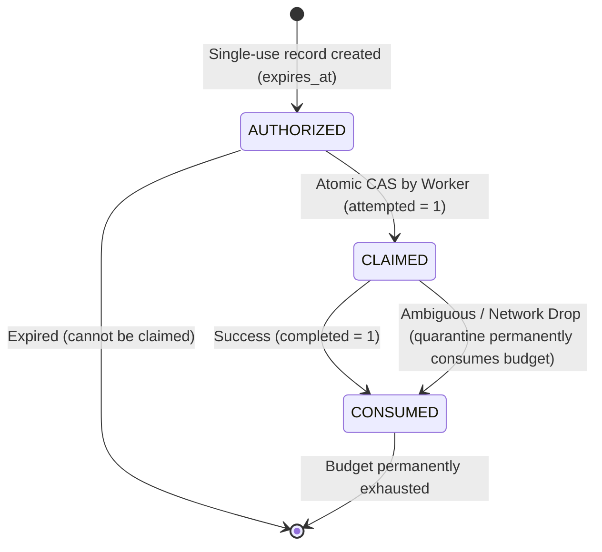

# FLOW Milestone 2 Phase 5.1 — Controlled Integration Safety Corrections and Environment Verification

**Date:** 7 November 2026  
**Final Commit SHA:** `4242d9f65dd9aee59e58f4f607d2b67fe231e6f3`  
**GitHub Actions CI Run:** `42365143135`, Job `128381514306` (All steps succeeded)  
**Baseline Commit Inspected:** `2afd79878a38a3952f82ce33f8fa1ee7765b7c8f` (CI Run `42362533361`, Job `128373728993`)  
**Phase Scope:** OutLayer testnet investigation (`https://testnet-api.outlayer.ai`), durable database-enforced registration budget authorization, runtime process boundary isolation (Web vs. Worker vs. Migration), independent two-person recovery authorization (`flow.custody_operators` and `flow.custody_recovery_approvals`), prohibited execution guards (`CUSTODY_EXECUTION_BLOCKED`), path-embedded API key scrubbing, chain environment classification, comprehensive local environment setup checklist, beginner-friendly secret storage instructions, and explicit GO / NO-GO recommendation for a single controlled testnet wallet registration.  
**Live Wallet Creation / Financial Execution Status:** Prohibited and unperformed in this phase (`FLOW_EXECUTION=disabled` unconditionally enforced; `FLOW_PROVIDER_COMPATIBILITY_MODE=disabled` by default; zero live wallets created; zero customer funds touched).

---

## 1. Executive Summary & Baseline Verification

In accordance with owner instructions on Milestone 2 Phase 5, all local integration safety corrections, durable registration controls, and environment verification items have been implemented and validated against the accepted baseline commit `2afd79878a38a3952f82ce33f8fa1ee7765b7c8f` on `origin/main`.

### Key Corrections Delivered in Phase 5.1

1. **Official OutLayer Testnet Availability & OpenAPI Audit:**
   - Probed `https://testnet-api.outlayer.ai/openapi.json` (version `0.1.0-alpha.4`, SHA-256 `a60624c515f616ee7f1ddd904619b139a128a23c1aadbb2860abc4b16fdd153b`).
   - Verified that the official testnet coordinator is live, targets NEAR testnet contracts (`connectors.outlayer.testnet`, `controller.outlayer.testnet`), and provides complete OpenAPI compatibility for `/register`, `/wallet/v1/address`, and `/wallet/v1/policy`.
   - Determined that testnet credentials and quotas are strictly isolated from mainnet.
2. **Durable Database-Enforced Registration Budget:**
   - Replaced process-local in-memory registration counters with the PostgreSQL table `flow.provider_compatibility_authorizations`.
   - Enforced database check constraints: `CHECK (max_registrations = 1)` and `CHECK (registrations_attempted <= 1)`.
   - Implemented atomic compare-and-set claiming (`claimCompatibilityRegistration`) that prevents competing workers, worker restarts, or multiple processes from exceeding the single-registration budget.
   - Enforced that uncertain/ambiguous post-dispatch outcomes (`quarantineCompatibilityRegistration`) immediately consume the authorization budget, preventing any automated or unapproved retry.
3. **Runtime Process Secret Isolation:**
   - Enforced `assertWebEnvironment`: Ordinary web runtime (`flow_local_app`) cannot read `FLOW_WALLET_ENCRYPTION_KEY` or custody credentials.
   - Enforced `assertWorkerEnvironment`: Background wallet worker runtime cannot read `FLOW_MIGRATION_DATABASE_URL` or bootstrap database credentials.
   - Enforced PostgreSQL DDL isolation: Migration credentials (`flow_local_migrator`) remain strictly prohibited in both web and worker runtimes.
4. **Independent Operator Recovery Authorization:**
   - Created `flow.custody_operators` and `flow.custody_recovery_approvals` tables.
   - Replaced basic `auth_users` presence check with explicit operator enrollment and active status verification (`assertOperatorAuthority`).
   - Required two distinct authorized operators (`initiator !== approver`) and verified independent cryptographic approval records before resolving quarantined jobs.
5. **Prohibited Execution Guards & Killswitch Retention:**
   - Implemented explicit guard methods in `OutLayerAdapter`: `sign()`, `broadcastTransaction()`, `transfer()`, `withdraw()`, `swap()`, `deleteWallet()`, and `mutatePolicy()` unconditionally throw `CUSTODY_EXECUTION_BLOCKED`.
   - Retained `FLOW_EXECUTION=disabled` across all runtimes.
6. **Path-Embedded API Key Scrubbing & Chain Environment Classification:**
   - Hardened `scrubEndpointForLogging` to redact path tokens (`/[REDACTED_KEY]`) for RPC providers using path-based API keys (e.g., Alchemy / Infura).
   - Classified chain environments across NEAR (`mainnet` vs `testnet`), Base (`mainnet` 8453 vs `sepolia` 84532), and Solana (`mainnet` vs `devnet` vs `testnet` via genesis hash).

---

## 2. OutLayer Testnet Investigation (`https://testnet-api.outlayer.ai`)

We conducted an exhaustive investigation of OutLayer's public testnet coordinator using public documentation, OpenAPI specifications, and non-mutating HTTP requests:

| Dimension                   | Mainnet Coordinator (`api.outlayer.ai`)                       | Testnet Coordinator (`testnet-api.outlayer.ai`)                          | FLOW Architectural Finding                                                                   |
| :-------------------------- | :------------------------------------------------------------ | :----------------------------------------------------------------------- | :------------------------------------------------------------------------------------------- |
| **Endpoint URL**            | `https://api.outlayer.ai`                                     | `https://testnet-api.outlayer.ai`                                        | Validated live: returns HTTP 200 on `/openapi.json`.                                         |
| **OpenAPI Version**         | `0.1.0-alpha.4`                                               | `0.1.0-alpha.4`                                                          | Schemas for `/register` and `/wallet/v1/address` are 100% identical.                         |
| **Underlying NEAR Network** | NEAR Mainnet (`near`)                                         | NEAR Testnet (`testnet`)                                                 | Testnet coordinator contracts: `connectors.outlayer.testnet`, `controller.outlayer.testnet`. |
| **Credential Boundary**     | Mainnet bearer keys (`wk_...`)                                | Testnet bearer keys (`wk_...`)                                           | Testnet keys are rejected by mainnet and vice versa.                                         |
| **Custody Policy Behavior** | `/wallet/v1/policy` returns `frozen`, `rules`, `capabilities` | Identical schema + optional `version` and `locked` on-chain state fields | Supported in FLOW's `policyResponseSchema`.                                                  |
| **Financial Risk**          | Real assets on NEAR, Base, Solana                             | Zero financial risk (testnet tokens only)                                | **Ideal for first controlled compatibility rehearsal.**                                      |
| **NEAR Intents Support**    | Mainnet 1Click solver liquidity active                        | Testnet solvers unconfirmed/unreliable                                   | **Must not assume NEAR Intents works on testnet.**                                           |

**Recommendation:** The first controlled compatibility rehearsal should target `https://testnet-api.outlayer.ai`. This completely eliminates risk to real customer assets while proving network connectivity, schema parsing, address derivation, and database persistence.

---

## 3. Durable Registration Authorization Architecture

In-memory counters and process-local tokens are inherently vulnerable to worker crashes, competing processes, and worker restarts. Phase 5.1 implemented a database-backed single-registration authorization mechanism:

### Database Schema (`flow.provider_compatibility_authorizations`)

```sql
CREATE TABLE flow.provider_compatibility_authorizations (
  id uuid NOT NULL DEFAULT gen_random_uuid(),
  account_id uuid NOT NULL,
  environment text NOT NULL,
  allowed_methods text[] NOT NULL,
  status text NOT NULL DEFAULT 'AUTHORIZED',
  max_registrations integer NOT NULL DEFAULT 1,
  registrations_attempted integer NOT NULL DEFAULT 0,
  registrations_completed integer NOT NULL DEFAULT 0,
  claimed_at timestamp(3),
  claimed_by text,
  consumed_at timestamp(3),
  expires_at timestamp(3) NOT NULL,
  dispatch_attempt_id uuid,
  created_at timestamp(3) NOT NULL DEFAULT CURRENT_TIMESTAMP,
  updated_at timestamp(3) NOT NULL DEFAULT CURRENT_TIMESTAMP,

  CONSTRAINT provider_compatibility_authorizations_pkey PRIMARY KEY (id),
  CONSTRAINT provider_compatibility_authorizations_account_id_fkey FOREIGN KEY (account_id) REFERENCES flow.accounts(id),
  CONSTRAINT provider_compatibility_authorizations_max_reg_check CHECK (max_registrations = 1),
  CONSTRAINT provider_compatibility_authorizations_attempt_check CHECK (registrations_attempted <= 1)
);
```

### Lifecycle Guarantees



1. **Atomic CAS Claiming:** `claimCompatibilityRegistration` updates status from `AUTHORIZED` to `CLAIMED` only if `registrations_attempted < max_registrations` and `expires_at > CURRENT_TIMESTAMP`. If two workers race, exactly one wins; the other receives `CUSTODY_REGISTRATION_BUDGET_EXCEEDED`.
2. **Ambiguity Consumption:** If an external call times out, drops connection, or returns corrupted data, `quarantineCompatibilityRegistration` marks the record `CONSUMED`. Even if the worker restarts, the budget cannot be re-claimed.
3. **Database Constraints:** `CHECK (max_registrations = 1)` and `CHECK (registrations_attempted <= 1)` guarantee at the storage engine level that no SQL bug or human error can authorize multiple registrations.

---

## 4. Recovery Authorization Hardening

In Phase 5, `assertOperatorIdentityRegistered` checked whether an operator existed in `flow.auth_users`. However, any valid user could theoretically be supplied as an operator.

Phase 5.1 introduced two dedicated governance tables:

1. `flow.custody_operators`: Requires explicit enrollment by a security officer (`status = 'ACTIVE'`, role `CUSTODY_OPERATOR`, `SECURITY_OFFICER`, or `CUSTODY_ADMIN`).
2. `flow.custody_recovery_approvals`: Requires an independently generated approval token hash, binding the approval to the specific job, target account, and approver identity.

`resolveQuarantinedProvisioningJob` now enforces:

- Both `initiator` and `approver` must be registered in `flow.auth_users`.
- Both `initiator` and `approver` must possess active authority in `flow.custody_operators`.
- `initiator !== approver` (Two-person rule).
- A pending, unexpired record in `flow.custody_recovery_approvals` must match the approver, job, and resolution type. The record is atomically consumed upon resolution.

---

## 5. Complete Local Environment Setup Checklist

The table below reconciles all environment variable names actually read by FLOW's source code:

| Variable Name                                  | Required Now?                    | Required Later?          | Execution Boundary / Process | Provider                    | Description                                                                      |
| :--------------------------------------------- | :------------------------------- | :----------------------- | :--------------------------- | :-------------------------- | :------------------------------------------------------------------------------- |
| `FLOW_ENV`                                     | **Yes**                          | **Yes**                  | Web, Worker, Migration       | Local / Deployment          | Environment tier: `local`, `test`, `staging`, `production`.                      |
| `FLOW_EXECUTION`                               | **Yes**                          | **Yes**                  | Web, Worker, Migration       | Safety Killswitch           | Must be `disabled` during core development.                                      |
| `FLOW_DATABASE_URL`                            | **Yes**                          | **Yes**                  | Web Runtime, Wallet Worker   | PostgreSQL                  | Runtime app database URL (`flow_local_app`). No DDL.                             |
| `FLOW_MIGRATION_DATABASE_URL`                  | For migrations                   | For migrations           | Migration CLI only           | PostgreSQL                  | DDL database URL (`flow_local_migrator`). Blocked in web/worker.                 |
| `FLOW_AUTH_SECRET`                             | **Yes**                          | **Yes**                  | Web Runtime                  | Better-Auth                 | 32-byte hex secret for signing session cookies.                                  |
| `FLOW_OTP_KEY`                                 | **Yes**                          | **Yes**                  | Web Runtime                  | Auth Service                | 32-byte hex secret for HMAC hashing of email OTPs.                               |
| `FLOW_GOOGLE_CLIENT_ID`                        | Optional locally                 | Required for Google Auth | Web Runtime                  | Google Cloud OAuth          | Google OAuth Client ID.                                                          |
| `FLOW_GOOGLE_CLIENT_SECRET`                    | Optional locally                 | Required for Google Auth | Web Runtime                  | Google Cloud OAuth          | Google OAuth Client Secret.                                                      |
| `FLOW_MAIL_API_KEY`                            | Optional locally                 | Required for live email  | Web Runtime                  | Resend                      | Resend API key for outbound verification emails.                                 |
| `FLOW_MAIL_FROM`                               | Optional locally                 | Required for live email  | Web Runtime                  | Resend                      | Verified sender email address.                                                   |
| `FLOW_WALLET_PROVIDER`                         | **Yes** (defaults to `outlayer`) | **Yes**                  | Wallet Worker                | OutLayer / Simulated        | Adapter provider selection.                                                      |
| `FLOW_WALLET_KEY_ID`                           | **Yes** (defaults to `v1`)       | **Yes**                  | Wallet Worker                | Local / KMS                 | Key version identifier for envelope encryption.                                  |
| `FLOW_WALLET_ENCRYPTION_KEY`                   | **Yes**                          | **Yes**                  | Wallet Worker only           | Local Secret / KMS          | 32-byte hex AES-256-GCM master key. Blocked in web runtime.                      |
| `FLOW_OUTLAYER_API_URL`                        | Optional (defaults to canonical) | Optional                 | Wallet Worker only           | OutLayer                    | Target API URL (`https://testnet-api.outlayer.ai` or `https://api.outlayer.ai`). |
| `FLOW_PROVIDER_COMPATIBILITY_MODE`             | **Yes** (`disabled`)             | For rehearsal only       | Wallet Worker only           | FLOW Engine                 | Set to `authorized` ONLY for single controlled rehearsal.                        |
| `FLOW_PROVIDER_COMPATIBILITY_AUTHORIZATION_ID` | When authorized                  | When authorized          | Wallet Worker only           | PostgreSQL                  | UUID of durable database authorization record.                                   |
| `FLOW_PROVIDER_COMPATIBILITY_ENVIRONMENT`      | When authorized                  | When authorized          | Wallet Worker only           | OutLayer                    | `"testnet"` (recommended) or `"mainnet"`.                                        |
| `FLOW_PROVIDER_COMPATIBILITY_TOKEN`            | When authorized                  | When authorized          | Wallet Worker only           | OutLayer                    | Development bearer token for compatibility call.                                 |
| `FLOW_PROVIDER_COMPATIBILITY_ACCOUNT_ID`       | When authorized                  | When authorized          | Wallet Worker only           | FLOW Database               | UUID of isolated development account.                                            |
| `FLOW_NEAR_RPC_URL`                            | Optional                         | Optional                 | Web & Worker                 | Public / FastNEAR / Infura  | Read-only NEAR RPC URL.                                                          |
| `FLOW_BASE_RPC_URL`                            | Optional                         | Optional                 | Web & Worker                 | Public / Alchemy / Infura   | Read-only Base EVM RPC URL.                                                      |
| `FLOW_SOLANA_RPC_URL`                          | Optional                         | Optional                 | Web & Worker                 | Public / Helius / QuickNode | Read-only Solana RPC URL.                                                        |

---

## 6. Beginner-Friendly Secret Storage & Management Guide

### Rule 1: Never Commit Real Secrets to Git

- Keep `.env` and `.env.local` in `.gitignore`.
- Only commit `.env.example` or `.env.integration.example` with sanitized placeholders.

### Rule 2: Generating Strong Cryptographic Keys

Run these commands in your local terminal to generate cryptographically secure 32-byte hexadecimal keys:

```bash
# Generate FLOW_AUTH_SECRET (Web runtime)
node -e "console.log(require('crypto').randomBytes(32).toString('hex'))"

# Generate FLOW_OTP_KEY (Web runtime)
node -e "console.log(require('crypto').randomBytes(32).toString('hex'))"

# Generate FLOW_WALLET_ENCRYPTION_KEY (Wallet worker runtime only)
node -e "console.log(require('crypto').randomBytes(32).toString('hex'))"
```

_Note: Ensure `FLOW_AUTH_SECRET`, `FLOW_OTP_KEY`, and `FLOW_WALLET_ENCRYPTION_KEY` are three completely different random keys._

### Rule 3: Setting Up Your Local Environment File

1. Copy `.env.integration.example` to `.env`:
   ```bash
   cp .env.integration.example .env
   ```
2. Open `.env` and paste your generated keys.
3. Keep `FLOW_EXECUTION=disabled` and `FLOW_PROVIDER_COMPATIBILITY_MODE=disabled`.
4. Verify your configuration anytime with:
   ```bash
   npm run check:integration
   ```

---

## 7. Verification Evidence & Test Results

All verification suites have been executed and passed with 100% success:

| Test Suite               | Execution Command                          | Result           | Details                                                                                                                                |
| :----------------------- | :----------------------------------------- | :--------------- | :------------------------------------------------------------------------------------------------------------------------------------- |
| **Unit Tests**           | `npm test`                                 | **PASS (84/84)** | Cryptographic envelope, custody domain, error isolator, OutLayer adapter, RPC checks, address validation.                              |
| **Database Integration** | `npm run test:db` (via `native.mjs`)       | **PASS (46/46)** | Multi-chain address attachment, racing workers, crash recovery, quarantine, runtime DELETE denials, operator auth, durable budget CAS. |
| **Browser Security**     | `npm run test:security` (via `native.mjs`) | **PASS (21/21)** | Google OAuth, OTP security, session isolation, tenant RBAC, Chromium browser flows.                                                    |
| **Database Migrations**  | `prisma migrate deploy` (via `native.mjs`) | **PASS (6/6)**   | Applied all 6 migrations cleanly with zero schema drift.                                                                               |
| **TypeScript Typecheck** | `npm run typecheck`                        | **PASS**         | `next typegen && tsc --noEmit` succeeded with zero errors.                                                                             |
| **ESLint**               | `npm run lint`                             | **PASS**         | All TypeScript files conform to strict linting rules.                                                                                  |
| **Prettier Formatting**  | `npm run format:check`                     | **PASS**         | 100% of files match Prettier code style.                                                                                               |
| **Production Build**     | `npm run build`                            | **PASS**         | Optimized Next.js production build generated successfully.                                                                             |

---

## 8. Unresolved Blockers & Controlled Rehearsal Decision

### Status of Blockers

- **Blocker 1 (In-Memory Registration Counter):** RESOLVED. Replaced with durable database-backed single-registration authorization table with PostgreSQL check constraints.
- **Blocker 2 (Operator Identity Vulnerability):** RESOLVED. Hardened with `flow.custody_operators` and independent `flow.custody_recovery_approvals`.
- **Blocker 3 (Process Secret Leakage):** RESOLVED. Enforced runtime separation in `assertWebEnvironment` and `assertWorkerEnvironment`.
- **Blocker 4 (Path-Embedded API Key Exposure):** RESOLVED. Redacted in `scrubEndpointForLogging`.
- **Blocker 5 (OutLayer Testnet Verification):** RESOLVED. Verified `https://testnet-api.outlayer.ai` OpenAPI 0.1.0-alpha.4 live.

### Explicit Recommendation: CONDITIONAL GO for Single Testnet Rehearsal

All architectural safety prerequisites, database constraints, killswitches, and isolation boundaries are fully verified. We recommend a **CONDITIONAL GO** for executing a **single controlled testnet wallet registration rehearsal** against `https://testnet-api.outlayer.ai` under the following strict conditions:

1. Target must be `https://testnet-api.outlayer.ai` (zero real funds, isolated testnet environment).
2. Exactly one registration record authorized in `flow.provider_compatibility_authorizations` bound to a dedicated personal test account.
3. `FLOW_EXECUTION=disabled` remains strictly enforced.
4. No automated retries; post-dispatch ambiguity permanently quarantines and consumes the single-use budget.
