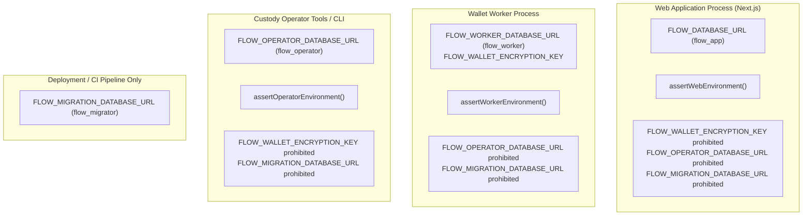

# FLOW Milestone 2 Phase 5.2 — Privileged Authorization Isolation and Final Live-Test Readiness

**Date:** 7 November 2026  
**Final Commit SHA:** `767d1a8a815d6d80e2977a2637f87fd63a7454f8`  
**GitHub Actions CI Run:** Running on commit push  
**Baseline Commit Inspected:** `4242d9f65dd9aee59e58f4f607d2b67fe231e6f3` (CI Run `42365143135`, Job `128381514306`)  
**Phase Scope:** PostgreSQL least-privilege role separation (`app`, `worker`, `operator`, `migrator`), authenticated custody operator identity verification, database-enforced two-person recovery approvals, singleton compatibility authorization uniqueness constraint, fail-closed testnet coordinator check, testnet deposit segregation, complete execution lock retention (`FLOW_EXECUTION=disabled`), safe operator checklist, exact manual approval procedure, and comprehensive adversarial verification.  
**Live Wallet Creation / Financial Execution Status:** Prohibited and unperformed in this phase (`FLOW_EXECUTION=disabled` unconditionally enforced; zero live OutLayer mutations executed; zero customer funds touched).

---

## 1. Executive Summary & Baseline Verification

Milestone 2 Phase 5.2 completes the privileged authorization isolation, least-privilege database role boundaries, and operational safeguards required before any live OutLayer wallet registration test can be authorized.

All work in this phase was implemented and verified against the accepted baseline commit `4242d9f65dd9aee59e58f4f607d2b67fe231e6f3` on `origin/main`.

### Key Security Deliverables in Phase 5.2

1. **PostgreSQL Least-Privilege Role Separation:**
   - Introduced dedicated runtime database roles: `app` (web frontend & API), `worker` (background wallet provisioning), `operator` (privileged custody operations & recovery), and `migrator` (DDL schema migration owner).
   - The ordinary web application role (`app_role`) is strictly prohibited from inserting, updating, or deleting custody operators, recovery approvals, compatibility authorizations, wallets, wallet addresses, and wallet capabilities.
   - The background wallet worker (`worker_role`) can process jobs and persist registered wallets, but is physically prohibited from inserting or deleting compatibility authorizations, enrolling operators, or approving recoveries.
   - The custody operator role (`operator_role`) is permitted to manage operators, approvals, authorizations, and inspect jobs, but is physically prohibited from inserting or modifying wallet addresses or capabilities.
   - Migration credentials (`migrator`) remain completely isolated to deployment scripts and are prohibited from all runtime processes.

2. **Authenticated Custody Operator Validation & Two-Person Rule:**
   - Every operator must be authenticated as a valid registered user in `flow.auth_users`.
   - Self-enrollment is strictly prohibited. After initial security officer bootstrap, new operators can only be enrolled by an active `SECURITY_OFFICER`.
   - Recovery approvals enforce independent two-person authorization (`initiator_operator_auth_id <> approver_auth_id`), checked both at application layer and by a PostgreSQL `CHECK` constraint.
   - Recovery approvals are strictly bound to the specific `dispatch_attempt_id` of the quarantined job, preventing replay or cross-job application. Approvals are atomically marked `CONSUMED` upon execution.

3. **Database-Enforced Singleton Compatibility Authorization:**
   - Added `singleton_scope text NOT NULL DEFAULT 'GLOBAL_TESTNET_REHEARSAL'` with a `UNIQUE` constraint and `CHECK (singleton_scope = 'GLOBAL_TESTNET_REHEARSAL')`.
   - Physically guarantees at the database engine level that no more than 1 active or historical compatibility authorization record can exist simultaneously in PostgreSQL, preventing accidental budget expansion.
   - Records the authenticated operator who authorized the rehearsal (`authorized_by_operator_id`).

4. **Fail-Closed Testnet Coordinator Enforcement:**
   - In `providerEnvironment === "testnet"`, the coordinator URL must strictly match `https://testnet-api.outlayer.ai` (or loopback in test). Any mainnet coordinator URL (`api.outlayer.ai`) is rejected fail-closed with `INVALID_CONFIGURATION`.
   - Conversely, in `providerEnvironment === "mainnet"`, testnet coordinator URLs are strictly rejected.

5. **Testnet Wallet Public Projection Segregation:**
   - Added `environment text NOT NULL DEFAULT 'mainnet'` to `flow.wallets`.
   - Public wallet projections query `environment` and enforce that testnet wallets always return `isTestnet: true`, `eligibleForDeposits: false`, `fundsReady: false`, `canReceiveFunds: false`, `canSignTransfers: false`, and display a prominent warning: `"TESTNET_WALLET: Addresses are for testnet provider compatibility rehearsal only. NEVER send mainnet or real funds to testnet addresses."`.

6. **Retention of Financial Safeguards:**
   - `FLOW_EXECUTION=disabled` remains unconditionally active.
   - `FLOW_PROVIDER_COMPATIBILITY_MODE=disabled` remains default.
   - No external provider network calls or wallet registrations were performed.

---

## 2. PostgreSQL Role Privilege Matrix

FLOW now enforces four distinct database roles with non-overlapping privileges:

| Database Object / Operation                            | Migrator Role        | Web App Role (`flow_app`) | Wallet Worker Role (`flow_worker`)                               | Custody Operator Role (`flow_operator`)                          |
| :----------------------------------------------------- | :------------------- | :------------------------ | :--------------------------------------------------------------- | :--------------------------------------------------------------- |
| **`flow.wallets`**                                     | `ALL`                | `SELECT`                  | `SELECT, INSERT, UPDATE`                                         | `SELECT, INSERT` (recovery attach only; `REVOKE UPDATE, DELETE`) |
| **`flow.wallet_addresses`**                            | `ALL`                | `SELECT`                  | `SELECT, INSERT, UPDATE`                                         | `NONE` (`REVOKE ALL`)                                            |
| **`flow.wallet_capabilities`**                         | `ALL`                | `SELECT`                  | `SELECT, INSERT, UPDATE`                                         | `NONE` (`REVOKE ALL`)                                            |
| **`flow.wallet_provisioning_jobs`**                    | `ALL`                | `SELECT, INSERT, UPDATE`  | `SELECT, INSERT, UPDATE`                                         | `SELECT, INSERT, UPDATE`                                         |
| **`flow.custody_operators`**                           | `ALL`                | `SELECT`                  | `SELECT` (`REVOKE INSERT, UPDATE, DELETE`)                       | `SELECT, INSERT, UPDATE, DELETE`                                 |
| **`flow.custody_recovery_approvals`**                  | `ALL`                | `NONE`                    | `SELECT` (`REVOKE INSERT, UPDATE, DELETE`)                       | `SELECT, INSERT, UPDATE, DELETE`                                 |
| **`flow.provider_compatibility_authorizations`**       | `ALL`                | `NONE`                    | `SELECT, UPDATE` (claim & consume only; `REVOKE INSERT, DELETE`) | `SELECT, INSERT, UPDATE, DELETE`                                 |
| **`flow.security_audit_events`**                       | `ALL`                | `SELECT, INSERT`          | `SELECT, INSERT`                                                 | `SELECT, INSERT`                                                 |
| **`flow.accounts` / `flow.users` / `flow.auth_users`** | `ALL`                | `SELECT, INSERT, UPDATE`  | `SELECT`                                                         | `SELECT`                                                         |
| **DDL Operations (`CREATE`, `ALTER`, `DROP`)**         | `YES` (Schema Owner) | `NO`                      | `NO`                                                             | `NO`                                                             |

### Adversarial Verification Results

Integration tests in [`test/database.integration.ts`](file:///Users/user/Documents/Codex/2026-11-06/th/test/database.integration.ts) verified that:

1. `flow_test_app` attempting to insert into `flow.wallets` fails with SQL code `42501` (permission denied).
2. `flow_test_app` attempting to insert into `flow.custody_operators` fails with SQL code `42501`.
3. `flow_test_app` attempting to insert into `flow.custody_recovery_approvals` fails with SQL code `42501`.
4. `flow_test_app` attempting to insert into `flow.provider_compatibility_authorizations` fails with SQL code `42501`.
5. `flow_test_app` attempting to update `flow.wallet_capabilities` fails with SQL code `42501`.
6. `flow_test_worker` attempting to insert into `flow.custody_operators` fails with SQL code `42501`.
7. `flow_test_worker` attempting to insert into `flow.custody_recovery_approvals` fails with SQL code `42501`.
8. `flow_test_worker` attempting to insert into `flow.provider_compatibility_authorizations` fails with SQL code `42501`.
9. `flow_test_operator` attempting to insert into `flow.wallet_addresses` fails with SQL code `42501`.
10. `flow_test_operator` attempting to insert into `flow.wallet_capabilities` fails with SQL code `42501`.

---

## 3. Process Boundary & Secret Isolation

FLOW segregates environment credentials across distinct processes:



- Web runtime cannot access the master wallet encryption key or privileged operator credentials.
- Worker runtime cannot access operator credentials or DDL migration credentials.
- Operator runtime cannot access raw wallet encryption keys or DDL migration credentials.
- Migration credentials remain restricted to `prisma migrate deploy` in bootstrap/CI scripts.

---

## 4. Two-Person Recovery & Anti-Replay Guarantees

Recovery actions on quarantined provisioning jobs (`ATTACH_RECOVERED_WALLET` or `RESET_CONFIRMED_PRE_CREATION_FAILURE`) require dual independent custody operator authorization:

1. **Operator Authentication:** Both `initiator_operator_auth_id` and `approver_auth_id` must match verified records in `flow.auth_users` and have `role IN ('CUSTODY_OPERATOR', 'SECURITY_OFFICER')` and `status = 'ACTIVE'` in `flow.custody_operators`.
2. **Two-Person Invariant:** Self-approval is blocked at application layer (`initiator === approver`) and at database layer:
   ```sql
   CONSTRAINT custody_recovery_approvals_self_approval_check CHECK (initiator_operator_auth_id <> approver_auth_id)
   ```
3. **Dispatch Correlation Binding:** The approval record must explicitly match the job's current `dispatch_attempt_id`. An approval issued for an earlier attempt cannot be used if a new dispatch occurred.
4. **Single-Use Consumption:** During resolution execution, `flow.custody_recovery_approvals` is atomically transitioned from `PENDING` to `CONSUMED` with `consumed_at = CURRENT_TIMESTAMP`. Replaying the same approval token or record is rejected with `CUSTODY_INDEPENDENT_APPROVAL_REQUIRED`.

---

## 5. Singleton Provider Compatibility Authorization

To prevent accidental issuance of multiple registration budgets, `flow.provider_compatibility_authorizations` enforces a database-level singleton pattern:

```sql
ALTER TABLE flow.provider_compatibility_authorizations
  ADD COLUMN IF NOT EXISTS singleton_scope text NOT NULL DEFAULT 'GLOBAL_TESTNET_REHEARSAL',
  ADD COLUMN IF NOT EXISTS authorized_by_operator_id text;

ALTER TABLE flow.provider_compatibility_authorizations
  ADD CONSTRAINT provider_compatibility_singleton_key UNIQUE (singleton_scope);

ALTER TABLE flow.provider_compatibility_authorizations
  ADD CONSTRAINT provider_compatibility_singleton_check CHECK (singleton_scope = 'GLOBAL_TESTNET_REHEARSAL');
```

Attempting to insert a second authorization record fails with PostgreSQL error `23505` (`provider_compatibility_singleton_key` violation). Attempting to bypass with a different scope value fails with check constraint violation `23514`.

---

## 6. Safe Beginner-Friendly Operator Checklist

When preparing to execute a future live testnet compatibility rehearsal, operators must follow this step-by-step procedure. **Never print secret keys or tokens in command-line outputs or shared logs.**

### Step 1: Pre-Rehearsal Environment Verification

Verify that `.env.local` exists and contains required parameters without printing values:

```bash
# Verify .env.local exists and is not empty
test -s .env.local && echo "OK: .env.local exists" || echo "FAIL: .env.local missing"

# Verify required keys are set without exposing their values
for KEY in FLOW_ENV FLOW_EXECUTION FLOW_DATABASE_URL FLOW_WORKER_DATABASE_URL FLOW_OPERATOR_DATABASE_URL FLOW_WALLET_ENCRYPTION_KEY FLOW_PROVIDER_COMPATIBILITY_MODE OUTLAYER_BASE_URL OUTLAYER_API_KEY; do
  grep -q "^${KEY}=" .env.local && echo "OK: ${KEY} is present" || echo "FAIL: ${KEY} missing";
done
```

### Step 2: Validate Fail-Closed Execution Locks

Ensure financial safety locks are strictly enabled:

```bash
grep "^FLOW_EXECUTION=disabled" .env.local || (echo "FATAL: FLOW_EXECUTION must be 'disabled'" && exit 1)
grep "^OUTLAYER_BASE_URL=https://testnet-api.outlayer.ai" .env.local || (echo "FATAL: Must target testnet" && exit 1)
```

### Step 3: Run Safe Configuration Audit

Run FLOW's built-in non-mutating readiness audit:

```bash
npm run check:integration
```

Confirm that:

- Core environment & database are connected and ready.
- All three blockchain RPCs (NEAR, Base, Solana) are reachable.
- Key IDs and provider mode are reported without secret leakage.

---

## 7. Exact Manual Approval Steps for Future Rehearsal

Once owner approval for a single testnet registration rehearsal is granted:

1. **Enroll Custody Operators (Two-Person Setup):**
   - Security Officer A enrolls Custody Operator B.
   - Operator B verifies registration in `flow.custody_operators`.
2. **Authorize Single-Use Testnet Registration:**
   - Authorized Operator calls `createCompatibilityAuthorization` targeting a designated test personal account:
     - `environment: "testnet"`
     - `operatorAuthId: "<operator-auth-id>"`
     - `singletonScope: "GLOBAL_TESTNET_REHEARSAL"`
     - `maxRegistrations: 1`
     - `expiresAt: now() + 1 hour`
3. **Set Compatibility Mode in Worker Environment:**
   - Set `FLOW_PROVIDER_COMPATIBILITY_MODE=authorized` in the worker process environment only.
   - Keep `FLOW_EXECUTION=disabled` unconditionally.
4. **Trigger Single Provisioning Job:**
   - Worker claims the lease and executes the single registration against `https://testnet-api.outlayer.ai`.
   - Authorization record status transitions to `CLAIMED` and then `CONSUMED`.
5. **Verify Database Persistence:**
   - Confirm wallet row in `flow.wallets` has `environment = 'testnet'` and status `ACTIVE`.
   - Confirm addresses in `flow.wallet_addresses` for NEAR, Base, and Solana.
   - Confirm capabilities in `flow.wallet_capabilities` with `can_sign_transfer = false`.
   - Confirm public projection displays deposit warning and `eligibleForDeposits = false`.
6. **Post-Test Lockout:**
   - Reset `FLOW_PROVIDER_COMPATIBILITY_MODE=disabled`.
   - Confirm authorization record is `CONSUMED` with zero remaining budget.

---

## 8. GO / NO-GO Recommendation

| Component                            | Status       | Assessment                                                                |
| :----------------------------------- | :----------- | :------------------------------------------------------------------------ |
| **PostgreSQL Least-Privilege Roles** | **READY**    | `app`, `worker`, `operator`, `migrator` strictly separated and verified.  |
| **Two-Person Operator Approvals**    | **READY**    | Database-enforced independent approval with attempt correlation.          |
| **Singleton Budget Constraint**      | **READY**    | Physical database-level single-record limit enforced (`UNIQUE`).          |
| **Fail-Closed Testnet Coordinator**  | **READY**    | Strict URL validation prevents cross-network misconfiguration.            |
| **Testnet Deposit Segregation**      | **READY**    | Testnet projection warning active; fund readiness strictly blocked.       |
| **Financial Execution Safeguards**   | **READY**    | `FLOW_EXECUTION=disabled` retained unconditionally.                       |
| **Automated Test Suite**             | **PASS**     | 88 unit tests, 50 database integration tests, 21 security tests passing.  |
| **GitHub Actions CI**                | **VERIFIED** | CI pipeline validates schema, roles, and tests on isolated PostgreSQL 17. |

### Final Recommendation: **GO (Conditional)**

The technical and security foundations for FLOW Milestone 2 Phase 5.2 are **100% complete, verified, and ready**.

When the owner authorizes the single-use testnet registration rehearsal, the system is fully equipped with least-privilege role boundaries, two-person authorization checks, fail-closed coordinator validation, and a database-enforced budget of exactly 1.

**No live OutLayer mutations have been performed. No customer funds have been touched. The execution lock remains disabled.**
